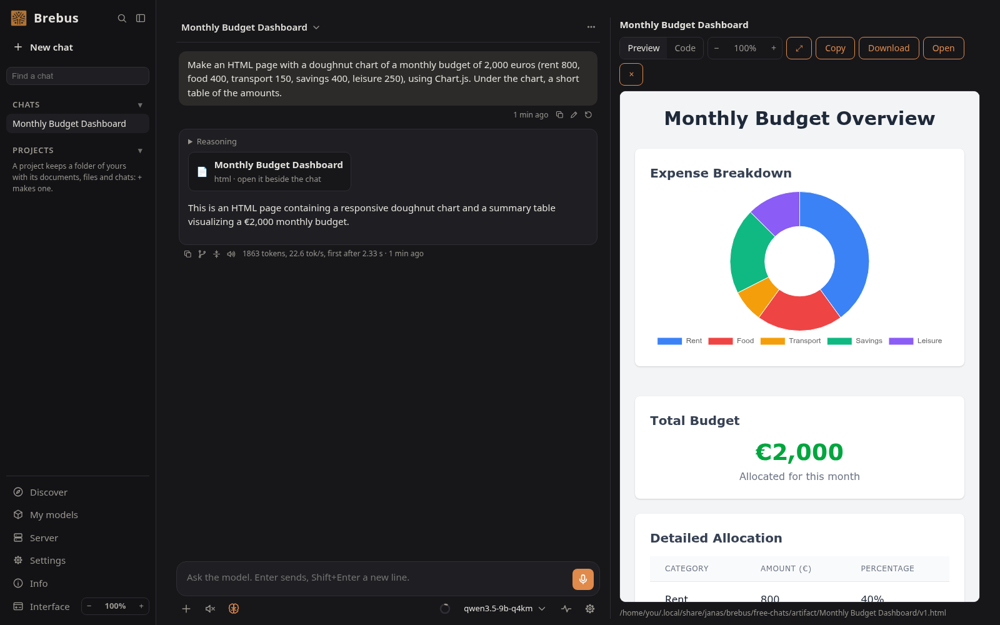
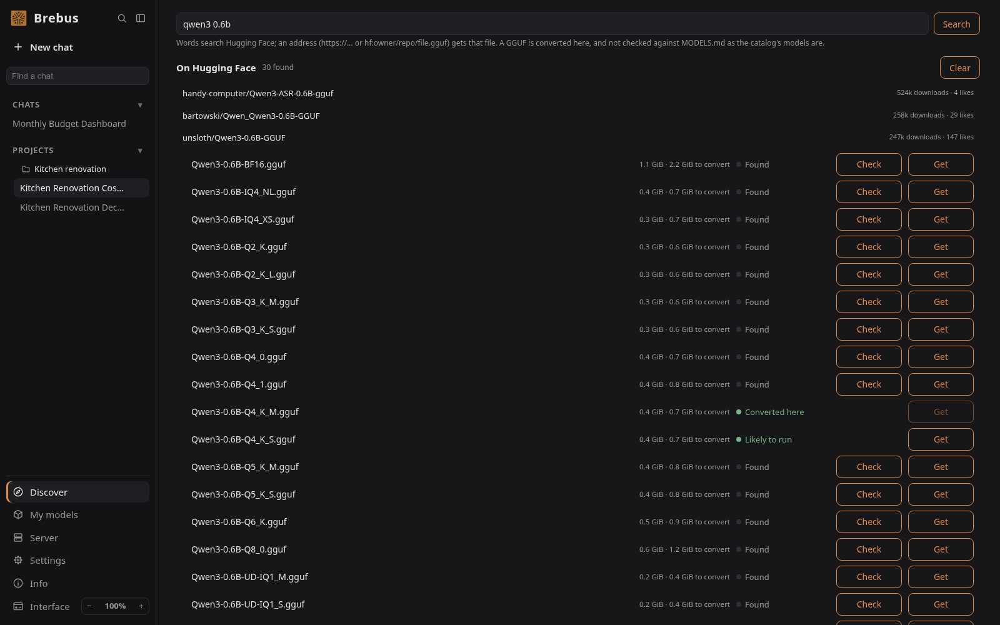

# Brebus

Brebus is Janas's app: the models of your computer, a chat with them and a server for other programs, in a window of its own. Nothing leaves the computer unless you ask it to: the models run on it, your chats and documents stay on it. *Brebus*, in Sardinian, are the magic words of the *janas*. It runs on Linux and Windows; macOS is not supported yet.



## Get it

| | |
|---|---|
| Linux x86-64 (Ubuntu 22.04, Debian 12 and later) | the release's `janas-linux-x86_64.tar.gz`: unpack it and start `./brebus` |
| Windows 10 and 11 x86-64 | the release's `janas-windows-x86_64.zip`: unpack it and start `brebus.exe` |

Releases: [github.com/prabanta-dev/janas/releases](https://github.com/prabanta-dev/janas/releases). Brebus carries Janas-LLM and its tools beside it (`janas-server`, `janas-get`, the converters, the services); nothing else needs installing.

- **Linux:** the window is WebKitGTK's (`libwebkit2gtk-4.1`; on Debian and Ubuntu the package `libwebkit2gtk-4.1-0`), loaded when Brebus starts. Where it is missing, or there is no display, Brebus opens its page in the browser.
- **Windows:** the window is WebView2, the engine of Edge that Windows 10 and 11 carry, through `WebView2Loader.dll` beside `brebus.exe` (Microsoft's, under its BSD licence, `LICENSE-WebView2.txt`).

From a terminal:

```sh
./brebus                    # its window
./brebus --install-desktop  # Linux: in the desktop's menu, with its icon
./brebus --browser          # in the browser instead
./brebus --no-open          # neither: http://127.0.0.1:41414/
./brebus --port 41500       # another port
./brebus --workspace DIR    # open that folder as a project
```

## The first start

The window opens maximized the first time; afterwards it opens where it was left, at the size it had (on Windows, also on the screen it was on, or on the main one if that screen is gone; on Linux with Wayland the desktop places it, and only the size and maximized state are kept). On Windows its frame follows the system's light or dark theme.

Brebus opens on a new chat, of no project: nothing of it is written, and it is not listed, until its first message; the other chats are in the side bar. Its first message names it for a start (its first sentence, at most eight words); after the first reply, while the model is free, the model gives it a title of a few words, unless you renamed it (a message sent meanwhile stops that). With no model on the computer, the model button under the field says *Choose a model*: *Other models…* in its menu, or *Discover* in the side bar, lists the models Janas knows, with how much each one downloads and how much memory it is meant for. *Get* downloads one, checked against its published fingerprint; then it is chosen under the field and loads by itself. From then on Brebus loads, at each start, the model of the chat it opens, or the one used last; with none remembered, the largest installed model that leaves half the memory free.

At each start Brebus opens the chat used last, in its project or among the free chats; if that chat is gone or archived, the newest free chat, or a new one.

## The window


**The side bar**, from the top:

- the magnifier (Ctrl+K) opens *Find a chat*; the panel icon (Ctrl+B) hides the bar to a strip of icons, and its right edge, dragged, widens it;
- *New chat* (Ctrl+Shift+O): a chat of no project;
- *Find a chat*: the chats whose title or messages hold the words typed, in every project;
- **Chats**: the free chats, the newest first; a **Projects** group, each project with its chats; **Archived**, folded. The arrow beside each group's name folds it; under the pointer, `+` makes a new chat (or, beside *Projects*, a new project), and `⋯` beside a chat opens its menu without opening it: *Open*, *Rename*, *Move to…*, *Duplicate*, *Export*, *Archive* or *Restore*, *Delete*;
- at the bottom, the pages: *Discover*, *My models*, *Server*, *Settings*, *Info*.

**The chat's bar**, over the conversation: its title opens what is done to the chat (*Rename*, *Move to…*, *Duplicate*, *Export*, *In a new window*, *Archive*, *Delete*); the project it belongs to is named beside it; `⋯` at the right lists the chat's artifacts and the pictures its replies showed, the files attached to it, and *Instructions and answer*.

**Under the field**, from the left: `+` attaches a file or a web address; the speaker reads the replies aloud (grey and crossed off: off; orange: on); the brain, for a model that can reason before answering, turns its reasoning on (orange) or off for this chat, at any message, at once: it goes with each request (a new chat starts as the model's *Think before answering* says, off unless *yes*); then, at the right, the ring of the model's memory, the model that answers (its menu chooses another, or *Other models…*), the engine's monitor and the model's settings (the gear).

**Zoom**: Ctrl+wheel, Ctrl+plus and Ctrl+minus make the whole window larger or smaller, Ctrl+0 brings it back to 100%; the side bar's foot shows it always, *Interface* with `−`, the percentage (click it for 100%; in the accent colour while it is not 100%) and `+`, for who does not use the keys. *Settings › Appearance* has the same steps, and Brebus remembers the zoom. In a browser the browser's own zoom does this. An artifact has a zoom of its own (below).

## Chats and projects

A **chat** belongs to no project: its conversation is kept in Brebus's data folder, and the model's tools see only that folder.

A **project** is a folder of yours, for work that goes on: the model searches and reads its documents, writes there what it makes for you (artifacts, exports, files), and its chats are kept in it (`.brebus/chats/`). `+` beside *Projects* opens one: a recent folder, a folder you choose (*Browse…* opens the system's own dialog), or a new one, `Documents/Brebus/<date>`. The home folder itself and `/` are refused, too wide for a model's files. `⋯` beside a project opens its settings: the folders to read only beside it, the services, the model that searches its documents by meaning.

A chat moves between the free chats and the projects (*Move to…*). An **archived** chat is kept to read: it no longer takes messages, and *Restore it* brings it back.

**Find a chat** (the magnifier): words, and where to look for them - titles and messages, your messages only, or titles only; every project, the free chats or one project; any time, today, the last week, month or year; one model; archived chats too or not. The results are in a list; one opens its chat.


| In a project's folder | |
|---|---|
| `.brebus/chats/` | its chats, a JSON file each |
| `artifact/` | what the model made to keep, `artifact/<title>/v1.html`, `v2.html`... |
| `exports/` | the chats exported in Markdown |
| `sources/` | the files attached by copy, and the web pages downloaded, each with `<name>.url.txt` (its address and when) |
| `.brebus/workspace.json` | the folders and files added to read only |
| `.brebus/data/`, `.brebus/config/` | the index of its documents, and its list |

## A conversation

- **The reply** is shown as it is written, in Markdown - all of CommonMark 0.31.2 and GitHub's extensions (tables, task lists, struck text, links written out), each example of both specifications among Brebus's tests; a line break inside a paragraph is shown, as GitHub shows comments; raw HTML is shown as its text, but for `<br>` and plain tags such as `<sup>` and `<kbd>`; a picture of the workspace is a card that opens it beside the chat, one of the web is not loaded - with formulas (between `$$`, `\(` `\)`, or single dollars when they are plainly a formula: `$5 and $10` stays money) code in colours, and diagrams: a ```mermaid block is drawn where it is, as a picture (Brebus's copy of Mermaid, strict, so it runs nothing). The model's reasoning is shown folded above it, and opens while it is being written too; while it is written, the pintadera keeps turning with *Reasoning…*, its seconds and the line the model is writing, and a click opens it; how many tokens came and how fast is shown under it.
- **Each message's actions**, under it, outside its box: on yours, when it was sent, then copy, *change this message and ask again from it*, and *go back to here* (the message and what follows taken away, its words put back in the field); on a reply, copy, *a new chat with the conversation up to this reply* (a branch, "Branch of …", to go on another way while the first stays as it is), read aloud and *summarize up to here*, then how fast it came and when. *Duplicate*, in the chat's menu, copies it whole.
- **An artifact's saved data** (what an app keeps between visits) are each chat's own, with their history: a branch gets them as they were at its reply, and going back to a message puts them back as they were there. The history is kept with each change and the point of the chat it was made at; past 20 MB for one artifact it is folded into the data of that moment, and an earlier point then gets the oldest data kept.
- **The ring under the field** fills as the chat takes the model's memory (its context): grey, orange from 70%, red from 90%. Under the pointer it shows the tokens used, the room, what is left and the model. When it reaches 80%, before your next message is sent, the model summarizes the earlier messages, all but the last two questions and their replies, and from then on reads the summary in their place: they stay in the chat, under a line that opens to the summary. *Compact now*, in the chat's menu, does it at once, and *summarize up to here*, under a reply, up to that reply. The project's instructions are never summarized. A small model writes a poorer summary; a new chat starts afresh. The room is set in the model's settings.
- **The field**: Enter sends, Shift+Enter starts a new line; while a reply comes, the button stops it, as Esc does. With the field empty, the button is a microphone (below, *Voice*).
- **Instructions and answer** (`⋯` in the chat's bar): what the model should be or do in this chat (its role, the language, how long its answers are); precise or creative answers; under *Advanced*, the temperature, top-p, and an answer in JSON (any object, or by a schema). Instructions can be kept under a name, to use again.
- **Export**: Markdown or plain text in the project's `exports/` (or Brebus's downloads), or a PDF through the system's print dialog.

## Documents and tools

For a project, Brebus starts [`janas-docs`](../src/services/docs/README.md), which indexes the project and the folders added to it (PDF, Word, Excel, PowerPoint, LibreOffice's, RTF, web pages, EPUB, text and Markdown), and [`janas-files`](../src/services/files/README.md), which reaches the project to read and write and the folders added only to read, not the rest of the home. Settings turns each of these on or off:

- **Search documents** (on): before each question, Brebus searches the project's documents for it and gives the model the passages found, each with its document. It works with models that cannot call tools. The passages are shown, folded, under the question. The documents are searched by their words, and by their meaning too with an embedding model of yours (the first, or the one chosen in the project's settings).
- **Tools** (on): the model may search and read the documents, list, read and search the files, and write in the project; a tool that writes runs only once you allow it, its arguments shown. Janas's services found beside Brebus (the web, Wikipedia, maps, weather, prices, flights, earthquakes, git, GitHub, this computer) and the MCP servers of your `~/.config/janas/mcp.json` (the format of Cursor and LM Studio) are offered as in `janas-chat`: a line for each, opened when a question needs it. A server of yours over HTTP that asks you to sign in (OAuth, as MCP's authorization says) has *Sign in* beside it in the project's settings: its own sign-in page opens in the browser, and the token it gives is kept for you alone (`~/.local/share/janas/mcp-auth`), renewed when it expires, and sent by `janas-chat` too; *Sign out* forgets it. A tool of your servers that does not say it only reads asks before it runs: *Allow*, *Don't allow*, or *Allow always in this chat* - for this chat alone and the server it was given to, asked again if the server's command, address or version changes, and, when the chat is taken up again, kept for as long after its last use as the project's settings say (a day by default; an hour to 30 days, for good, or never), where *Ask again in this chat* takes them back. A copy or a branch of a chat asks again. The tools of `autoApprove` in `mcp.json` run without asking; Janas's own tools that change something ask every time.
- **Attach** (`+` under the field): a file of this computer, or a web address. A file is copied into `sources/` or read where it is; a web address is downloaded into `sources/`. A document of up to 24,000 characters goes into the message whole; a longer one is named, for the model to search or read. A picture goes to the model as a picture when it sees pictures (Gemma 4, Qwen3.5: *My models* says "sees pictures"); a recording is transcribed by Whisper and the transcript goes into the message.

**Connectors**, in *Settings*: services of the web that speak MCP, added with a click - Notion, Linear, Atlassian, Sentry, Stripe, Hugging Face, Cloudflare, Zapier, Intercom, Supabase, Netlify and Microsoft Learn's and Cloudflare's documentation, each read from its maker's own documentation - then signed in to from a project's settings, Services (OAuth, above); and desktop extensions, the MCP Bundles (`.mcpb`) of Claude Desktop: Brebus reads the bundle's manifest, says whether its runtime is on this computer (Node.js, Python), asks for the settings it declares, unpacks it into `connectors/` beside `mcp.json`, every file kept inside its folder, and writes its entry in `mcp.json`, which janas-chat reads too. A bundle refused leaves the version installed as it was; *Remove* takes away its folder and its entry, the other entries as they were. Its program runs on this computer as its maker wrote it, not in a cage.

**Skills**, in *Settings*: instructions for particular tasks, which the model reads when a task needs them, in the format of Claude's skills - a folder with a `SKILL.md` (its name and description in a frontmatter, then the instructions) and the files it names. A skill made for Claude works here as it is. Those for every chat live in `skills/` beside `mcp.json` (`~/.config/janas/skills`, `%APPDATA%\janas\skills`), a project's own in its `.brebus/skills/`. The model's list of tools names each skill with its description, and the model reads one with `janas__skill` - its `SKILL.md`, or a file of its folder, never outside it - before the task; the scripts a skill names run with *Run code*, in its cage. *Settings* turns each on or off, adds one by copying its folder, and removes one of every chat's. Tried on 20 November 2026 with Gemma 4 E4B and a skill that counts words with a few lines of Python: asked only "Quante parole ha questo testo?" about a sentence, it read the skill, ran its code in the cage and answered 11, right.

## Run code

With *Run code* on (Settings; off by default), the model may run Python in a cage of Janas's own; each piece of code runs only once you allow it, its code shown. In the cage: no network, no other process, limits on memory and time (2 minutes a piece), the project's folder to read and write (the folders added to it, to read), nothing else of the computer. Variables stay from one piece to the next; a figure drawn with matplotlib is saved in the project, and opens beside the chat when the reply names it. With *Run code* off, the model is told it cannot run code, and not to report results of code it did not run.

- **Linux**: the system's Python 3, in namespaces with seccomp (`src/common/sandbox.c`).
- **Windows**: an AppContainer with no network and the project's folder alone, inside a Job Object (memory, a single process, no access to your windows or clipboard). Python is not part of Brebus: the first time *Run code* is turned on, Brebus says what it would download - Python 3.14 from python.org and numpy and matplotlib with what they need from PyPI, about 45 MB - and does so only on *Install*, each file checked by its SHA-256. *Settings* removes it.

## Artifacts

With *Artifacts* on (by default), what the model makes to see or keep opens in a pane beside the chat, and the reply shows a card in its place. The pane is widened by its left edge, or put over the chat with ⤢, beside its zoom (filled while it is over; again to put it back). Its bar has the artifact's own zoom, apart from the interface's: `−`, the percentage (click it for 100%) and `+`, or Ctrl+wheel with the pointer over the artifact. A page or a drawing made larger keeps the layout it has at 100% and the pane scrolls it; a document's text flows to the pane's width. Each artifact remembers its zoom. Its kinds are those of Claude's artifacts:

| Kind | Shown as |
|---|---|
| `html` | the page, its scripts run |
| `react` | a React component exported as default, its JSX read by Babel, Tailwind's classes, the imports of `react`, `recharts`, `lucide-react`, `d3`, `lodash`, `mathjs`, `papaparse`, `xlsx`, `chart.js`, `three`, `tone`, and shadcn/ui's components from `@/components/ui/...` (written for Brebus with the same names and props) |
| `mermaid` | the diagram |
| `svg` | the drawing |
| `markdown` | as the replies are, formulas with KaTeX |
| `code` | the program, its syntax in colours |

*Preview* and *Code* switch between the artifact and its text; *Copy*, *Download*, *Open* (the saved file, with the system's own program); the versions, each saved as `artifact/<title>/v1.html`, `v2.html`..., are paged through. A click on its title renames it, in the chat and in its folder. One the model left without a title takes the one it carries (a page's title, a document's first heading, a program's first comment), or `Untitled-001`, `Untitled-002`... An error of the artifact shows above it, with *Ask the model to fix it*.

A picture a reply names from the project (``, a file the model's code wrote) is a card too, and opens in the pane.

An artifact runs in a frame with no origin of its own and no network: it cannot reach Brebus, the page around it, the computer or the Internet. The libraries it may use - React 18.3.1, Recharts 2.13.3, lucide-react 0.460.0, D3 7.9.0, lodash 4.17.21, Papa Parse 5.4.1, math.js 13.2.2, Chart.js 4.4.6, Three.js r128, Plotly 2.35.2, SheetJS 0.18.5, Mermaid 11.4.1, KaTeX 0.16.11, highlight.js 11.10.0, Tone.js 15.0.4, mammoth 1.8.0, Tailwind 4.1.10, Babel 7.26.4 - come from Brebus: each file is downloaded once from jsdelivr's copy of npm when first needed, checked against the SHA-256 Brebus carries, and kept in Brebus's data folder; a page that asks for one of them from jsdelivr, unpkg or cdnjs gets Brebus's copy. They are not part of Janas: each keeps its own licence (MIT, BSD, ISC or Apache 2.0). Inside a page or a component, as in Claude's: `await window.claude.complete(prompt)` asks the model loaded; `window.storage` keeps the artifact's data between visits (in `artifact/<title>/storage.json`, 20 MB at most); `window.fs.readFile(name)` reads a file attached to the chat.

## Voice

- **Dictation**: with the field empty, its button is a microphone. Speak, click again, and what you said is written in the field by OpenAI's Whisper, run on this computer by Janas: nothing you say leaves it. The first time, Brebus offers to get the speech model: whisper-small (0.49 GB), from [`prabanta-dev/whisper-small-JNS`](https://huggingface.co/prabanta-dev/whisper-small-JNS), checked against its fingerprint. *Settings*, *Voice* has it and the more accurate large-v3-turbo (1.63 GB), each got or removed there. A speech model is used from the next time the chat's model loads. Windows asks once for the microphone.
- **Reading aloud**: the speaker under the field reads the replies with the computer's own voices; *Settings*, *Voice* chooses one. On Linux the voices come from speech-dispatcher (with espeak-ng, for example); Janas's own voices will come with its speech synthesis.

## Discover



- **The catalog**: the models Janas knows, converted and checked, with how much each downloads and the memory it is meant for ("fits", or "needs more": it still runs, slower, reading its parts from the disk). *Get* downloads one into the models' folder, checked against its published fingerprint.
- **One field to search or get**: words search Hugging Face for models with GGUF files, the most downloaded first; an address (`https://huggingface.co/…` or `hf:owner/repo/file.gguf`) gets that file. *Clear*, or emptying the field, brings the catalog back into view.
- **A model's files**, each with its size and the free space its conversion takes (about twice a GGUF's size), and **how far it is from running here**: *Found* (listed); *Check* reads its first megabyte and says *Likely to run* (its kind of model is one Janas runs; only the conversion and the first load prove it) or *Not supported yet*; *Not available* (a gated model, which wants its licence accepted on its page); *Converted here*, *Loaded here*. A GGUF is converted here after its download; a GGUF split in parts, or a vision encoder alone, is not offered.
- **Several downloads at once** (four at most), each with its progress and *Stop*; *Get* again goes on from where it stopped. A download starts only when the disk has room for it beside those going on, or Brebus says how much is needed and how much there is.

## My models

The models in the models' folder (`janas-get`'s, `$JANAS_MODELS`, or the one chosen with *Change…*), with their kind, size and context, and whether they see pictures. *Load* starts one (the one the chat uses reads *In use*, one loaded beside it *Use*: chosen at once); *Settings* (filled while open; *Close* closes them) says how it runs - how much of the chat it keeps in mind, in tokens with about as many words (three quarters of them), from 4,096 up to the most the model was trained for (by default 16,384, or that most when it is less), whether it thinks before answering (for the models that can), and under *Advanced* where it reads your message, checks its guesses and writes the reply (by default chosen by Janas, which tries the processor, the GPU and the NPU this computer has and keeps the fastest; one of them, or the NPU and the GPU together, to try a device or leave one free), how it reaches the graphics card (by default Vulkan, which every maker's card has, or where there is none the maker's own: CUDA for NVIDIA, HIP for AMD; or one of them chosen) and how many chats it answers at the same time - used the next time it loads; *Info* shows what Janas chose for the model loaded; *Remove* deletes it from the disk, with its prediction head and its vision encoder when no other model needs them.

## Server

The model loaded in Brebus can answer other programs too - an editor, a script, another chat app - through OpenAI's API at `/v1` and Ollama's and Anthropic's beside it, on this computer. *Server* shows the address for programs, the key, and the engine's monitor; its settings: how many models may be loaded at once, free the memory after so many minutes without a message (the model loads again with the next one), let other computers of the network use it (with a key, so that only those who know it may), encrypt it (HTTPS: Brebus makes a certificate for this computer, its names and addresses, kept in its data folder's `tls/` with the key readable by you alone, renewed before it expires; *Server* shows its SHA-256 fingerprint, for a program to compare before trusting it), and, under *Advanced*, the key and the web pages of other sites allowed to call it. See [serving](serving.md).

## Served, from a browser

`brebus --serve` runs Brebus without a window, for a browser on this computer or on others, with a login, for its administrators and for users each with their own chats and projects.

```sh
./brebus --add-user ada                          # an administrator; the password asked in the terminal, twice
./brebus --add-user bob --user                   # a user
./brebus --serve --listen 0.0.0.0 --port 41414   # then https://<this machine>:41414 in a browser
```

- **Accounts.** `--add-user NAME` makes one, or gives an existing one a new password; a password is 12 characters or more. They are kept in `users.json` in the data folder, readable by its owner alone: a password as PBKDF2-HMAC-SHA256 of it, a random salt and 600,000 iterations, never itself.
- **Administrators and users.** An administrator uses Brebus as its owner does, its data, its models, its settings. A user gets a Brebus of their own, started at their first request and given every request of theirs: their chats, projects, settings, skills and connectors under `users/<name>/` in the data folder, their projects in its `files/` alone. The models are the administrators', shared: a user loads one and talks to it, every user sees it loaded. Everything runs as the one user of the machine Brebus runs as, so a user cannot do what reaches beyond their folder: no MCP server that is a command on the machine (only connectors over HTTP), no desktop extension, no folder outside their own, no janas-system nor janas-git, no download or removal of models, no Python installed, no window's dialogs. *Run code* and the skills' scripts stay, in their cage. A user's own Brebus listens on `127.0.0.1` alone and answers only requests carrying its random token, which the front Brebus gives it; it ends with the front.
- **Users of the system, on Linux** (`brebus --serve --users system`). Instead of Brebus's own accounts, the users of the machine log in with their own password, the members of the group `brebus` as users and of `brebus-admin` as administrators; accounts of the system (uid below 1000) never. Each user's Brebus runs as them, in their home, with their files and their permissions: nothing of the list above is taken from them, as nothing they run there reaches beyond what their account may. The second factor stays Brebus's, kept in its data folder by their name. Their password is changed with `passwd`. An administrator uses the front's own Brebus, as with Brebus's accounts. It needs one privileged piece, `janas-brebus-helper`, beside `brebus`: it checks a password by PAM and starts a user's Brebus as them, nothing else. Installed by root, once:

  ```sh
  # Brebus's own account, not a user's, and not named brebus (that is the users' group)
  sudo useradd --system --create-home brebus-srv
  sudo groupadd brebus; sudo groupadd brebus-admin
  sudo usermod -aG brebus bob                 # a user; brebus-admin for an administrator
  sudo install -m 644 brebus.pam /etc/pam.d/brebus
  # the whole package root's, in a folder root's up to /: Brebus's account runs it, may not change it
  sudo cp -r . /opt/janas && sudo chown -R root:root /opt/janas && sudo chmod -R go-w /opt/janas
  sudo chown root:brebus-srv /opt/janas/janas-brebus-helper && sudo chmod 4750 /opt/janas/janas-brebus-helper
  sudo mkdir -p /etc/janas && echo "caller = brebus-srv" | sudo tee /etc/janas/brebus-helper.conf
  sudo -u brebus-srv /opt/janas/brebus --serve --users system --listen 0.0.0.0
  ```

  The helper serves only the account named in `/etc/janas/brebus-helper.conf`. It checks the password of members of `brebus` and `brebus-admin` alone, never of other accounts; it starts a user's Brebus only right after that user's login (a ticket it gives at the login, good once, for ten minutes); it refuses to start a `brebus` when it, any program beside it or in its `services/`, or any folder from `/` down to it, is not root's or could be written by someone else, and runs the very file it checked, with none of the front's open files. The models' folder must be readable by the users. Not on Windows yet.
- **A second factor, beyond this computer.** Listening on another address than `127.0.0.1`, Brebus asks every account for an authenticator's code (TOTP, the six digits of Aegis, Google Authenticator, 1Password, Bitwarden...). It is set up at the machine, not from afar (a stolen password would choose it): at the first login from a browser on this computer (`127.0.0.1`), which shows the secret to give the app and keeps it only when a code from it is right, or by `brebus --enroll NAME` in its terminal (`--users system` with users of the system); then ten recovery codes, each good once, shown once.
- **HTTPS, beyond this computer.** Brebus speaks HTTPS with a certificate it makes for this machine's names and addresses (the same as *Server*'s), or the one given with `--tls-cert` and `--tls-key`. The browser warns about Brebus's own certificate until it is trusted; its fingerprint is in *Server*.
- **Sessions.** A random 256-bit token in a cookie (`HttpOnly`, `SameSite=Lax`, `Secure` over HTTPS; what changes anything is a POST or a DELETE, whose origin is checked), ended after a week unused, thirty days in all, at logout, or when Brebus restarts.
- **From a browser**, where the page is not in Brebus's own window: *Attach* sends a file of the browser's computer (or one dropped on the chat) to Brebus, which keeps it in the workspace's `sources/`, up to 512 MB; *Browse…* shows the folders of the computer Brebus runs on in a dialog of the page, a user's only their own; *Log out* is in the side bar.
- **Your account**, in *Info*: who is logged in, the last logins, *Log out*, *Change the password* (the sessions in other browsers end with it) and *Log out elsewhere*.
- **Defences.** After five wrong tries from an address or for a name, each next one waits twice as long as the last, up to an hour. A request from another site's page is refused. Every login and failure is written to `logins.log` in the data folder, with its time and address.

Tried on 20 November 2026, with an administrator and a user: the user's own Brebus started and kept apart (their chats, their free chats' folder); a project outside their folder, a folder of the home to read, `/etc/passwd` attached, the window's dialog and a download all refused; janas-system and janas-git not offered to them; a model loaded by the user, seen loaded by the administrator, and the user's question answered through it; the user's Brebus refusing a request without its token or with another; all of them ended with the front; the same over HTTPS with the second factor (the artifacts' frame allowed for the HTTPS page). Also: an account made; on `127.0.0.1` a login, the API with the session and without (401), another site's page refused (403), logout, the pause after five wrong passwords; on `0.0.0.0` over HTTPS, the second factor set up with a code computed by a separate implementation of TOTP, the login with a code and with a recovery code, which a second time was refused. The same under AddressSanitizer: nothing found.

## Settings and Info

*Settings*: Search documents, Tools, Run code and Artifacts, each with what it does; *Voice*; *Appearance* (the window's zoom); *When the computer starts* (Brebus in the background at login, without its window, the model loaded for other programs); Python for Run code on Windows. *Info*: Brebus's version, its makers and licence, its source, this computer (its processor, instructions, memory now free, power, the model loaded) and the engine's monitor.

## Where Brebus keeps things

| | Linux | Windows |
|---|---|---|
| Brebus's data: settings, the free chats, the window's place, the artifacts' libraries, the server's log | `~/.local/share/janas/brebus` | `%LOCALAPPDATA%\janas\brebus` |
| The models | `~/.local/share/janas/models` | `%LOCALAPPDATA%\janas\models` |
| A project's chats and files | in the project's folder | in the project's folder |
| Python for Run code | the system's | `%LOCALAPPDATA%\janas\python` |

## How it works

`brebus` serves its page and a small API of its own (`/brebus/...`) on `127.0.0.1` only, and opens no model itself. *Get* runs the `janas-get` beside it into the models' folder. *Load* starts a `janas-server` beside it, on the next port, with the model and its settings. Up to four models may be loaded at once, each with its own server on the ports after (*Server* lists them, with their addresses, and unloads any one): choosing a model loaded already is immediate. A model is loaded beside the others when the memory free holds it; otherwise the ones used least lately are unloaded first. A model larger than half the memory, its experts read from the disk, runs alone. *Server*'s *Models loaded at once* sets fewer, 1 for one at a time. The page's chat goes to Brebus, which passes `/v1/...` and `/api/...` on to the server of the model they name, else to the one used last; other programs can use each server's address directly. The files and conversations other programs keep through the API are each server's own: the first's where `janas-server` keeps them, the others' beside it (`server-1`, `server-2`...). The key reaches `janas-server` in its environment, never on its command line, which every user of the machine can read. Brebus answers only requests for its own address, and refuses those of another site's page (`403`). It ends when its window is closed (or with Ctrl+C), and the model's server ends with it.

Its icon is the Prabanta logo, drawn for each size and system ([src/brebus/icons](../src/brebus/icons/README.md)). On Linux, when the window opens, Brebus writes its icons in `~/.local/share/icons/hicolor` and, where there is none, `brebus.desktop` in `~/.local/share/applications`.

## What has been tried

- **Windows 11** (a virtual machine, November 2026):
  - the window, a project in Documents, Qwen3-0.6B downloaded and answering (at temperature 0 the same text to the byte as on Linux), documents found, a system file outside the project refused, the artifacts' libraries;
  - chats and projects: moves, archives, the side bar's menus, *Find a chat* with its filters;
  - whisper-small got from the microphone's offer, and a 7-second Italian recording written word for word in 4.3 s;
  - a reply read aloud with the voice chosen;
  - Python downloaded on *Install*, a matplotlib figure drawn and saved; the network, the user's folders and the models refused; MemoryError at the limit; a loop stopped at 120 s; nothing left running when Brebus closes.

  Every check of the page's controls went through the page itself, with no errors in its console.
- **Linux**: earlier, with Qwen3-4B and Qwen3-30B-A3B:
  - a note attached and quoted;
  - "which river is in Lazio, and how long" answered "the Tevere, 405 km" from an Excel sheet in a folder read only, its document named;
  - a file written by the model once allowed;
  - the lines of a file counted by Python in the cage as `wc -l` counts them;
  - the weather of Cagliari from the weather service;
  - an HTML page with a chart made as an artifact;
  - an answer written again, a question edited, an answer in JSON by a schema;
  - the model unloaded after a quiet minute and loaded again by the next message;
  - a page's attempts to read Brebus, the network and the page around it, all refused;
  - with Gemma 4 E2B, a picture described and an Italian recording transcribed and summarised.
- **`tests/test_brebus`** starts `brebus` with no model and checks:
  - its page, its API, another site's page refused;
  - the free chats at the start; projects listed, a chat moved and refused outside Brebus's projects; the search's filters;
  - chats and settings saved, listed, read and deleted;
  - the project's tools, a folder read only, a file attached;
  - Python in the cage;
  - a model that is not there neither loaded, nor downloaded, nor removed;
  - Brebus ending on SIGTERM.
