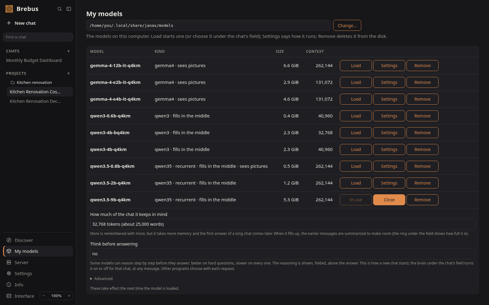

# Brebus

Brebus is Janas's app: the models of your computer, a chat with them and a server for other programs, in a window of its own. Nothing leaves the computer unless you ask it to: the models run on it, your chats and documents stay on it. It runs on Linux and Windows; macOS is not supported yet.


This is the guide to all of it, from installing it to every button.

- [Install it](#install-it) · [The first start](#the-first-start) · [The window](#the-window)
- [Chats and projects](#chats-and-projects) · [A conversation](#a-conversation) · [Documents and tools](#documents-and-tools) · [Run code](#run-code) · [Artifacts](#artifacts) · [Voice](#voice)
- [The models: Discover, My models](#the-models) · [Server](#server) · [Settings](#settings) · [Info](#info)
- [Served, from a browser](#served-from-a-browser) · [Keyboard](#keyboard) · [Command line](#command-line) · [Where Brebus keeps things](#where-brebus-keeps-things)
- [When something goes wrong](#when-something-goes-wrong) · [How it works](#how-it-works) · [What has been tried](#what-has-been-tried)

## Install it

Brebus comes with every release of Janas, and on its own page, [github.com/prabanta-dev/brebus](https://github.com/prabanta-dev/brebus/releases/latest). It carries Janas-LLM and its tools beside it (`janas-server`, `janas-get`, the converters, the services): nothing else needs installing.

### Windows

Windows 10 (1903 or later) and 11, x86-64.

- **The setup**, [`brebus-windows-x86_64-setup.exe`](https://github.com/prabanta-dev/brebus/releases/latest/download/brebus-windows-x86_64-setup.exe): it installs Brebus for you alone, with no administrator's rights, in `%LOCALAPPDATA%\Programs\Brebus`, with an entry in the Start menu and one on the desktop, and starts it at the end if you leave its box ticked. The setup is not signed yet: Windows says *Windows protected your PC*; *More info*, then *Run anyway*. To remove it: *Settings › Apps › Installed apps › Brebus › Uninstall*, which takes away the program, its entries and its start at login; your chats, projects and models stay (below, [where they are](#where-brebus-keeps-things)).
- **Without installing**, [`brebus-windows-x86_64.zip`](https://github.com/prabanta-dev/brebus/releases/latest/download/brebus-windows-x86_64.zip), or Janas's [`janas-windows-x86_64.zip`](https://github.com/prabanta-dev/janas/releases/latest/download/janas-windows-x86_64.zip): unpack it anywhere and start `brebus.exe`.

The window is WebView2, the engine of Edge that Windows 10 and 11 carry, through `WebView2Loader.dll` beside `brebus.exe` (Microsoft's, under its BSD licence, `LICENSE-WebView2.txt`).

### Linux

x86-64: Ubuntu 22.04, Debian 12 and later.

- **The .deb**, [`brebus_amd64.deb`](https://github.com/prabanta-dev/brebus/releases/latest/download/brebus_amd64.deb): `sudo apt install ./brebus_amd64.deb`. Brebus goes in `/opt/brebus-janas`, `brebus` on the PATH and in the desktop's menu with its icon. `sudo apt remove brebus-janas` takes it all away.
- **The .rpm**, [`brebus.x86_64.rpm`](https://github.com/prabanta-dev/brebus/releases/latest/download/brebus.x86_64.rpm), for the distributions that install .rpm packages: `sudo dnf install ./brebus.x86_64.rpm`, the same layout; `sudo dnf remove brebus-janas`.
- **Without installing**, [`brebus-linux-x86_64.tar.gz`](https://github.com/prabanta-dev/brebus/releases/latest/download/brebus-linux-x86_64.tar.gz), or Janas's [`janas-linux-x86_64.tar.gz`](https://github.com/prabanta-dev/janas/releases/latest/download/janas-linux-x86_64.tar.gz): unpack it and start `./brebus`; `./brebus --install-desktop` puts it in the desktop's menu, with its icon, for you (`~/.local/share/applications`).

The window is WebKitGTK's (`libwebkit2gtk-4.1-0` on Debian and Ubuntu, `webkit2gtk4.1` with .rpm packages: the packages recommend it), loaded when Brebus starts. Where it is missing, or there is no display, Brebus opens its page in the browser. Before removing a package, turn off *Start Brebus in the background* (Settings) if you turned it on: its entry is in your home, which a package does not touch.

### From the sources

Brebus is built with the rest of Janas, by `./build.sh`: [Getting started](../README.md#getting-started). Its sources are in `src/brebus/`.

## The first start

The window opens maximized the first time; afterwards it opens where it was left, at the size it had (on Windows, also on the screen it was on, or on the main one if that screen is gone; on Linux with Wayland the desktop places it, and only the size and the maximized state are kept). On Windows its frame follows the system's light or dark theme.

Brebus always opens on **a new chat, of no project**: nothing of it is written, and it is not listed, until its first message; the other chats are in the side bar, a click away. Started with `--workspace DIR`, it opens that folder as a project instead, with a new chat in it.

**The first model.** With no model on the computer, the model button under the field says *Choose a model*: *Other models…* in its menu, or *Discover* in the side bar, lists the models Janas knows, with how much each downloads and how much memory it is meant for. *Get* downloads one, checked against its published fingerprint; then it is chosen under the field and loads by itself. From then on, at each start, Brebus loads by itself the model of the chat open, or else the one used last, or, with none remembered, the largest installed model that leaves half the memory free. While a model loads, the field is off and says *Loading <model>…*; it is on again as soon as the model answers.

**A chat's title**: its first message names it for a start (its first sentence, at most eight words); after the first reply, while the model is free, the model gives it a title of a few words, unless you renamed it (a message sent meanwhile stops that).

## The window


### The side bar

From the top:

- **Brebus**, then the **magnifier** (Ctrl+K), which opens *Find a chat*, and the **panel button** (Ctrl+B), which shrinks the bar to a strip of icons and back; Brebus remembers which. Its right edge, dragged, widens it (from 200 pixels to almost half the window), remembered too. When an artifact or a picture opens beside the chat in a window narrower than 1500 pixels, the bar becomes a strip by itself, and comes back when the pane closes.
- **New chat** (Ctrl+Shift+O): a chat of no project.
- **Find a chat**, a field: the chats whose title or messages hold the words typed, in every project, found as you type; each result with its project and the words around what was found. A click opens the chat. *Find a chat* behind the magnifier has more filters ([below](#find-a-chat)).
- **Chats**: the free chats, the newest first. **Projects**: each project, with its chats; the one open is marked. **Archived**: folded, and hidden while it is empty. A click on a group's name, or on a project, folds it; Brebus remembers what is folded.
- Under the pointer, `+` beside *Chats* makes a new free chat, beside *Projects* a new project, beside a project a new chat in it; `⋯` beside a project opens its settings; `⋯` beside a chat opens its menu without opening it: *Open*, *Rename*, *Move to…* (another project, or the free chats), *Duplicate*, *Export*, *Archive* or *Restore*, *Delete*. On the chat open, `⋯` gives the menu of its title (below). A chat's model is named when the pointer rests on it.
- At the bottom, the pages: **Discover** (the models to get), **My models** (those on this computer), **Server** (the model for other programs), **Settings**, **Info**; then **Interface**, the size of the whole window ([Zoom](#zoom)); and, when Brebus is served with a login, **Log out**.

### The chat's bar

Over the conversation:

- **Its title**, a button: *Rename*; *Move to…*; *Duplicate* (a copy, "Copy of …", to take another way); *Compact now* (the earlier messages summarized, to make room: [The memory of a chat](#the-memory-of-a-chat)); *Export* (Markdown, text or PDF); *In a new window* (the chat in a window of its own, Brebus's too); *Archive* (kept to read, no longer continued) or *Restore*; *Delete*, asked first. After *Delete*, the newest chat opens, or a new one.
- **The project** it belongs to, named beside the title (its folder under the pointer); nothing for a free chat.
- **`⋯`** at the right: the chat's artifacts and the pictures its replies showed, each opened beside the chat with a click; the files attached to it, each opened with this computer's own program for it; and **Instructions and answer** ([below](#instructions-and-answer)).

An archived chat says so above the field, which is gone: *This chat is archived: it can be read, not continued*, and *Restore it*.

### The field and the row under it

- **The field**: Enter sends, Shift+Enter starts a new line; it grows with its text. The files attached wait above it, each with its `×`. While a reply comes, the button at its right stops it, as Esc does; with the field empty, the button is a microphone ([Voice](#voice)). Files dropped on the chat are attached.
- Under it, from the left: **`+`** attaches a file or a web address ([Attach](#attach)); **the speaker** reads the replies aloud (grey and crossed off: off; orange: on; remembered); **the brain**, only for a model that can reason before answering: its reasoning on (orange) or off for this chat, at any message, at once.
- Then a few words when something is under way: *Loading <model>…*, *loads with your message* (the model was unloaded after a quiet while: it loads again with the next message), *writing what you said…*, Python being installed.
- At the right: **the ring** of the model's memory ([below](#the-memory-of-a-chat)); **the model** that answers, whose menu chooses another (each with its size, *sees pictures*, *loaded*) or *Other models…*; **the monitor** of the engine, live, in a window of its own: the reply being written, the memory and the devices the model uses; **the gear**, this model's settings ([My models](#my-models)): changed while the model runs, Brebus asks whether to load it again now to use them.

### Zoom

The whole window, larger or smaller: **Interface** at the side bar's foot, `−`, the percentage and `+` (a click on the percentage brings it back to 100%; it is in the accent colour while it is not 100%), or **Ctrl+wheel**, **Ctrl+plus** and **Ctrl+minus**, **Ctrl+0** for 100%. The steps: 50, 67, 75, 80, 90, 100, 110, 125, 150, 175, 200, 250 and 300%. *Settings › Appearance* has the same steps, and Brebus remembers the zoom. In a browser the browser's own zoom does this, and *Interface* is not shown. An artifact has a zoom of its own, in its bar ([Artifacts](#artifacts)): Ctrl+wheel with the pointer over it zooms it alone.

## Chats and projects

A **chat** belongs to no project: its conversation is kept in Brebus's data folder, and the model's tools see only that folder.

A **project** is a folder of yours, for work that goes on: the model searches and reads its documents, writes there what it makes for you (artifacts, exports, files), and its chats are kept in it (`.brebus/chats/`).

### A project's dialog

`+` beside *Projects* opens a project:

- one of the **recent** folders;
- a folder of your choice: its path, or **Browse…** (the system's own dialog; in a browser, a dialog of the page), then **Open**; a folder that is not there is made, asked first;
- **New folder**: a new one in `Documents/Brebus`, named by today's date (`2026-11-23`, then `2026-11-23 (2)`...).

The home folder itself and `/` are refused, too wide for a model's files.

`⋯` beside a project opens the same dialog with that project's settings below:

- **Search by meaning**: the embedding model that searches its documents by meaning beside their words, or *words only*.
- **Services**: Janas's services and your MCP servers, each with a switch; *Sign in* and *Sign out* for a server over HTTP that asks for a sign-in; how long a tool allowed always in a chat stays allowed when the chat is taken up again (an hour, 8 hours, a day, a week, 30 days, for good, never; a day by default); *Ask again in this chat*. See [Documents and tools](#documents-and-tools).
- **Read only, beside it**: folders and files the model may search and read, never write - documents, code, pictures, audio; *remove* takes one away (nothing in it is deleted).

### Moving, archiving, copying

A chat moves between the free chats and the projects (*Move to…*). **Archived**, it is kept to read: it no longer takes messages, and *Restore* brings it back. **Duplicate** copies it whole; **a branch**, from a reply ([below](#each-messages-buttons)), copies it up to that reply.

### Find a chat

The magnifier (Ctrl+K): the words (empty: every chat the filters keep), and where to look for them - **In** titles and messages, your messages only, or titles only; **Where** everywhere, the free chats, or one project; **When** any time, today, the last week, month or year; **Model** any, or one; **archived too** (ticked at first). It says how many it found; each result has its title, date, project, model, and the words around what was found. A click opens the chat.


### Export

*Export*, in a chat's menu: **Markdown** or **Text**, a file in the project's `exports/` (for a free chat, the free chats' own `exports/` in Brebus's data folder), named after the chat's title; Brebus says where it put it. Only the words said go in, not the tools' calls. **PDF**, for the chat open only: the system's print dialog (*Print to file*), the chat alone, without the side bar and the buttons.

### In a project's folder

| | |
|---|---|
| `.brebus/chats/` | its chats, a JSON file each |
| `artifact/` | what the model made to keep: `artifact/<title>/v1.html`, `v2.html`..., and each chat's saved data of it |
| `exports/` | the chats exported |
| `sources/` | the files attached by copy, and the web pages downloaded, each with `<name>.url.txt` (its address and when) |
| `.brebus/workspace.json` | the folders and files added to read only |
| `.brebus/data/`, `.brebus/config/` | the index of its documents, and its list |
| `.brebus/skills/` | its own skills |

## A conversation

### The reply

- **As it is written**: before its first word, the pintadera's five points light up in turn; with a long message, *Reading your message…* and how far. A reply that reasons shows *Reasoning…*, its seconds and the line it is writing; a click opens the reasoning. The marks of Markdown are drawn as they come: a word in `**` is bold at once, never shown with its asterisks. The chat follows the reply while you are at its end; scrolled up, it stays where you are.
- **Markdown**, all of CommonMark 0.31.2 and GitHub's extensions (tables, task lists, struck text, links written out), every example of both specifications among Brebus's tests. A line break inside a paragraph is shown, as GitHub shows comments. Raw HTML is shown as its text, but for `<br>` and plain tags such as `<sup>` and `<kbd>`.
- **Formulas**, between `$$`, `\(` `\)` and `\[` `\]`, or single dollars when they are plainly a formula (`$5 and $10` stays money), drawn by KaTeX; **code** in colours, in the light or dark theme; **diagrams**: a ```mermaid block is drawn where it is, as a picture (Brebus's copy of Mermaid, strict, so it runs nothing).
- **The reasoning**, folded above the reply, in Markdown too; it opens while it is written as well.
- **A tool the model called** is a folded box with its name, its arguments and its answer (*not allowed* when you refused it).
- **Links**: a click asks first - *A link the model wrote*: it was written by an AI, not by a person; check it before you trust it - and opens it in the browser. Only `http` and `https` links open.
- **Pictures**: one of the project is a card that opens it beside the chat; one of the web is not loaded.
- **Under the reply**: how many tokens came, how fast, and after how long the first; *stopped* when you stopped it.
- **A reply that failed** says so in its place - an error, or *no answer* when the model's server ended without a word (it may have stopped: see My models, Server) - and it is left out, with its question, of what the model reads next.

### Each message's buttons

Under each message, outside its box, shown while no reply is coming:

- **Yours**: when it was sent (*now*, *5 min ago*, *2 h ago*...; the date under the pointer), then **copy**; **change this message and ask again from it** (what came after it is replaced by the new answer); **go back to here**: this message and what follows are taken away and its words put back in the field, asked first (a branch first keeps them, if you want them).
- **A reply**: **copy**; **branch**, a new chat with the conversation up to this reply ("Branch of …"), to go on another way while the first stays as it is; **summarize up to here** ([below](#the-memory-of-a-chat)); **read it aloud** (again: stop); then how fast it came, and when.

An artifact's **saved data** (what an app keeps between visits) are each chat's own, with their history: a branch gets them as they were at its reply, and going back to a message puts them back as they were there. The history is kept with each change and the point of the chat it was made at; past 20 MB for one artifact it is folded into the data of that moment, and an earlier point then gets the oldest data kept.

A chat written by an older Brebus may have a reply written again, with `‹ 1/2 ›` under it to page through its versions.

### The memory of a chat

**The ring under the field** fills as the chat takes the model's memory, its context: grey, orange from 70%, red from 90%. Under the pointer it shows the tokens used, the room, what is left (with about as many words) and the model.

**When it reaches 80%**, before your next message is sent, the model summarizes the earlier messages - all but the last two questions and their replies - and from then on reads the summary in their place. They stay in the chat, under a line, *Summarized up to here*, that opens to the summary. **Compact now**, in the chat's menu, does it at once, keeping only the last question and its reply whole; **summarize up to here**, under a reply, up to that reply. The chat's instructions are never summarized. A small model writes a poorer summary; a new chat starts afresh. How much the model keeps in mind is set in its settings ([My models](#my-models)).

### Instructions and answer

`⋯` in the chat's bar, *Instructions and answer*: what the model should be or do in this chat (its role, the language, how long its answers are), and **its answers**: as the model answers by itself, precise (temperature 0.2), or creative (1.0). Under **Advanced**: the temperature (0 to 2), top-p (0 to 1), and **answer as** text, any JSON object, or JSON by a schema you write (checked as JSON). **Keep these instructions to use again**, under a name: then *Use saved instructions* offers them in every chat.

### The reasoning

For a model that can reason step by step before it answers (Qwen3, Qwen3.5, Gemma 4...), the brain under the field turns it on or off for the chat, at any message, at once: it goes with each request. A new chat starts as the model's *Think before answering* says ([My models](#my-models)), off unless *yes*. A reasoning with no limit is closed while the context still holds the answer.

## Documents and tools

For a project, Brebus starts [`janas-docs`](../src/services/docs/README.md), which indexes the project and the folders added to it (PDF, Word, Excel, PowerPoint, LibreOffice's, RTF, web pages, EPUB, text and Markdown), and [`janas-files`](../src/services/files/README.md), which reaches the project to read and write and the folders added only to read, not the rest of the home. *Settings* turns each of these on or off:

- **Search documents** (on): before each question, Brebus searches the project's documents for it and gives the model the passages found, each with its document. It works with models that cannot call tools. The passages are shown, folded, under the question. The documents are searched by their words, and by their meaning too with an embedding model of yours (the first, or the one chosen in the project's settings).
- **Tools** (on): the model may search and read the documents, list, read and search the files, and write in the project. A message may take up to seven rounds of tools; an answer asked in JSON takes none.

### Asked before it runs

A tool that changes something runs only once you allow it: *The model wants to run …*, with its arguments - or its code, for Python - and **Allow** or **Don't allow**. Tools that only read run without asking.

Janas's services found beside Brebus (the web, Wikipedia, maps, weather, prices, flights, earthquakes, git, GitHub, this computer) and the MCP servers of your `~/.config/janas/mcp.json` (`%APPDATA%\janas\mcp.json`; the format of Cursor and LM Studio) are offered as in `janas-chat`: a line for each, opened when a question needs it. A tool of your servers that does not say it only reads asks before it runs: *Allow*, *Don't allow*, or **Allow always in this chat** - for this chat alone and the server it was given to, asked again if the server's command, address or version changes, and, when the chat is taken up again, kept for as long after its last use as the project's settings say, where *Ask again in this chat* takes them back. A copy or a branch of a chat asks again. The tools of `autoApprove` in `mcp.json` run without asking; Janas's own tools that change something ask every time.

A server of yours over HTTP that asks you to sign in (OAuth, as MCP's authorization says) has **Sign in** beside it in the project's settings: its own sign-in page opens in the browser, and Brebus says *Signed in* when it is done. The token it gives is kept for you alone (`~/.local/share/janas/mcp-auth`), renewed when it expires, and sent by `janas-chat` too; **Sign out** forgets it.

### Attach

`+` under the field: a file of this computer, by its path or with **Browse…**, or a web address, downloaded into the project's `sources/`.

- **A file outside the project**: Brebus asks whether to **copy** it into `sources/` (the project stays whole, and the file is read as it is now) or to **read it where it is** (added to the folders read only, it follows its changes). A copy is offered first up to 100 MB, reading in place above; *Do the same for files up to (over) 100 MB* remembers the choice.
- **What the model gets**: a document of up to 24,000 characters goes into the message whole; a longer one is named, for the model to search or read. A picture goes to the model as a picture when it sees pictures (Gemma 4, Qwen3.5: *My models* says *sees pictures*); one that does not is told so. A recording is transcribed by Whisper and the transcript goes into the message.

From a browser, *Attach* sends a file of the browser's computer instead ([below](#served-from-a-browser)).

### Connectors

In *Settings*:

- **Services on the web** that speak MCP, added with a click - Notion, Linear, Atlassian, Sentry, Stripe, Hugging Face, Cloudflare, Zapier, Intercom, Supabase, Netlify, and Microsoft Learn's and Cloudflare's documentation, each read from its maker's own documentation - then signed in to from a project's settings, *Services*. *Remove* takes one out of `mcp.json`.
- **Desktop extensions**, the MCP Bundles (`.mcpb`) of Claude Desktop: a bundle's path, or *Browse…*, then **Install**. Brebus reads the bundle's manifest, says whether its runtime is on this computer (Node.js, Python), asks for the settings it declares, unpacks it into `connectors/` beside `mcp.json`, every file kept inside its folder, and writes its entry in `mcp.json`, which janas-chat reads too. A bundle refused leaves the version installed as it was; *Remove* takes away its folder and its entry, the other entries as they were. Its program runs on this computer as its maker wrote it, not in a cage.

### Skills

In *Settings*: instructions for particular tasks, which the model reads when a task needs them, in the format of Claude's skills - a folder with a `SKILL.md` (its name and description in a frontmatter, then the instructions) and the files it names. A skill made for Claude works here as it is.

Those for every chat live in `skills/` beside `mcp.json` (`~/.config/janas/skills`, `%APPDATA%\janas\skills`), a project's own in its `.brebus/skills/`. *Settings* turns each on or off, **adds** one by copying its folder (its path, or *Browse…*), and removes one of every chat's. The model's list of tools names each skill with its description, and the model reads one with `janas__skill` - its `SKILL.md`, or a file of its folder, never outside it - before the task; the scripts a skill names run with *Run code*, in its cage. A skill added is seen from the next message.

Tried on 20 November 2026 with Gemma 4 E4B and a skill that counts words with a few lines of Python: asked only "Quante parole ha questo testo?" about a sentence, it read the skill, ran its code in the cage and answered 11, right.

## Run code

With *Run code* on (*Settings*; off by default), the model may run Python in a cage of Janas's own; each piece of code runs only once you allow it, its code shown. In the cage: no network, no other process, limits on memory and time (2 minutes a piece), the project's folder to read and write (the folders added to it, to read), nothing else of the computer. Variables stay from one piece to the next; a figure drawn with matplotlib is saved in the project, and opens beside the chat when the reply names it. With *Run code* off, the model is told it cannot run code, and not to report results of code it did not run.

- **Linux**: the system's Python 3, in namespaces with seccomp (`src/common/sandbox.c`). *Run code* is not offered where there is no Python.
- **Windows**: an AppContainer with no network and the project's folder alone, inside a Job Object (memory, a single process, no access to your windows or clipboard). Python is not part of Brebus: the first time *Run code* is turned on, Brebus says what it would download - Python 3.14 from python.org and numpy and matplotlib with what they need from PyPI, about 45 MB - and does so only on *Install*, each file checked by its SHA-256, into `%LOCALAPPDATA%\janas\python`, for Brebus alone. *Settings › Python, for Run code* removes it.

## Artifacts

With *Artifacts* on (by default), what the model makes to see or keep opens in a pane beside the chat, and the reply shows a card in its place (*being written…* while it comes). A whole HTML page or SVG drawing in a reply's code block opens there too.

### The pane

Its bar, from the left:

- **The title**: a click renames it, in the chat and in its folder (a name the chat has already is refused).
- **The versions**, when there are more than one, each saved as `artifact/<title>/v1.html`, `v2.html`...: a list to choose one.
- **Preview** and **Code**: the artifact, or its text as the model wrote it.
- **Its zoom**, apart from the interface's: `−`, the percentage (click it for 100%) and `+`, or Ctrl+wheel with the pointer over the artifact, or Ctrl+plus, Ctrl+minus and Ctrl+0 inside it. A page or a drawing made larger keeps the layout it has at 100% and the pane scrolls it; a document's text flows to the pane's width. Each artifact remembers its zoom.
- **⤢**: wide, over the chat (filled while it is over; again to put it back).
- **Copy** its text; **Download** it as a file of its own (`.html`, `.svg`, `.md`, `.jsx`, `.mmd`, `.py`...); **Open** the saved file with this computer's own program for it; **×** closes the pane.

The pane is widened by its left edge, remembered. Under the artifact, the file it is saved in. An error of the artifact shows above it, with **Ask the model to fix it**, which sends the error to the model to write the artifact again, and *Dismiss*.

A picture a reply names from the project (``, a file the model's code wrote) is a card too, and opens in the pane, with its zoom.

### Its kinds

Those of Claude's artifacts:

| Kind | Shown as |
|---|---|
| `html` | the page, its scripts run |
| `react` | a React component exported as default, its JSX read by Babel, Tailwind's classes, the imports of `react`, `recharts`, `lucide-react`, `d3`, `lodash`, `mathjs`, `papaparse`, `xlsx`, `chart.js`, `three`, `tone`, and shadcn/ui's components from `@/components/ui/...` (written for Brebus with the same names and props) |
| `mermaid` | the diagram |
| `svg` | the drawing |
| `markdown` | as the replies are, formulas with KaTeX |
| `code` | the program, its syntax in colours |

One the model left without a title takes the one it carries (a page's title, a document's first heading, a program's first comment), or `Untitled-001`, `Untitled-002`...

### What an artifact can do

An artifact runs in a frame with no origin of its own and no network: it cannot reach Brebus, the page around it, the computer or the Internet. Inside a page or a component, as in Claude's:

- `await window.claude.complete(prompt)` asks the model loaded (`window.janas` is the same);
- `window.storage` keeps the artifact's data between visits - `get`, `set`, `delete`, `list` - each chat's own, with its history (above);
- `window.fs.readFile(name)` reads a file attached to the chat; from a browser, Brebus asks you first, once for each artifact and file.

**brebus-kit**, the pieces an app is made of, the same in every one, so that the model composes them rather than writing them all: `Shell` (title and pages), `Stat`, `Form` (fields with their rules, checked), `Grid` (sorted, filtered, in pages, edited in place, rows deleted), `Chart` (bar, line, area, pie), `Upload` (CSV, Excel and JSON read into rows), `toast`, `confirm` and `useStored` (data kept between visits).

The libraries it may use - React 18.3.1, Recharts 2.13.3, lucide-react 0.460.0, D3 7.9.0, lodash 4.17.21, Papa Parse 5.4.1, math.js 13.2.2, Chart.js 4.4.6, Three.js r128, Plotly 2.35.2, SheetJS 0.18.5, Mermaid 11.4.1, KaTeX 0.16.11, highlight.js 11.10.0, Tone.js 15.0.4, mammoth 1.8.0, Tailwind 4.1.10, Babel 7.26.4 - come from Brebus: each file is downloaded once from jsdelivr's copy of npm when first needed, checked against the SHA-256 Brebus carries, and kept in Brebus's data folder (`lib/`); a page that asks for one of them from jsdelivr, unpkg or cdnjs gets Brebus's copy. They are not part of Janas: each keeps its own licence (MIT, BSD, ISC or Apache 2.0).

## Voice

- **Dictation**: with the field empty, its button is a microphone. Speak, click again, and what you said is written in the field - after what is there already - by OpenAI's Whisper, run on this computer by Janas: nothing you say leaves it. The first time, Brebus offers to get the speech model, whisper-small (0.49 GB), from [`prabanta-dev/whisper-small-JNS`](https://huggingface.co/prabanta-dev/whisper-small-JNS), checked against its fingerprint. A speech model is used from the next time the chat's model loads. Windows asks once for the microphone.
- **Reading aloud**: the speaker under the field reads the replies with the computer's own voices; under a reply, its loudspeaker reads that one. On Linux the voices come from speech-dispatcher (with espeak-ng, for example); Janas's own voices will come with its speech synthesis.

*Settings › Voice*: the speech models, whisper-small (small and quick, for dictation on most computers) and whisper-large-v3-turbo (1.63 GB, more accurate, for long recordings and difficult sound), each got or removed there; and the **voice** that reads aloud, among those of the page's language.

## The models

### Discover


- **The catalog**: the models Janas knows, converted and checked, with what each one is, how much it downloads and the memory it is meant for - *fits*, or *needs more*: it still runs, slower, reading its parts from the disk. This computer's memory is said above. **Get** downloads one into the models' folder, checked against its published fingerprint; *installed* when it is there.
- **One field to search or get**: words search Hugging Face for models with GGUF files, the most downloaded first, each with its downloads and likes; an address (`https://huggingface.co/…/file.gguf` or `.jns`, or `hf:owner/repo/file.gguf`) gets that file, and the button reads *Get*. **Clear**, or emptying the field, brings the catalog back.
- **A model's files**, a click on the model: each with its size and the free space its conversion takes (about twice a GGUF's size), and **how far it is from running here**: *Found* (listed); **Check** reads its first megabyte and says *Likely to run* (its kind of model is one Janas runs; only the conversion and the first load prove it), *Not supported yet*, or *Not known* (its header could not be read); *Not available* (a gated model, which wants its licence accepted on its page); *Converted here*, *Loaded here*. A GGUF is converted here after its download; a GGUF split in parts, or a vision encoder alone, is not offered.
- **The downloads**, four at most at once, each with its progress, its speed and **Stop**: *Get* again goes on from where it stopped. A download starts only when the disk has room for it beside those going on, or Brebus says how much is needed and how much there is. When one ends, it says so (*ready: load it in My models*, stopped, or why it failed), and the box goes after a few seconds.

### My models



- **The folder** of the models, and **Change…** to keep them in another one (one with more room, an external disk...). `$JANAS_MODELS`, when it is set, is the folder.
- **The table**: each model with its kind (*recurrent*, *fills in the middle*, *sees pictures*), size and context.
- **Load** starts one; the one the chat uses reads *In use*, one loaded beside it *Use*: chosen at once.
- **Remove** deletes it from the disk, asked first, with its prediction head and its vision encoder when no other model needs them; a model loaded is unloaded first. The model in use is chosen away first, under the chat's field.
- **Settings**, under each model (filled while open; *Close* closes them), kept for it and saved as you change them, used the next time it loads - the gear under the field opens the same, for the model of the chat:

| Setting | |
|---|---|
| **How much of the chat it keeps in mind** | its context, in tokens with about as many words (three quarters of them): 4,096 and each double, up to the most the model was trained for (40,960 for Qwen3, 262,144 for Qwen3.5), that one too. By default *Janas's own*: 16,384, or the model's most when it is less. More is remembered with more, but it takes more memory and the first answer of a long chat comes later. Brebus never asks for more than the model takes. |
| **Think before answering** | for the models that can reason: how a new chat starts (the brain changes it for a chat) |
| **Where it reads your message**, **checks its guesses**, **writes the reply** (*Advanced*) | by default chosen by Janas, which tries the processor, the GPU and the NPU this computer has and keeps the fastest; or the processor, the GPU, the NPU, or the NPU and the GPU together, to try a device or leave one free. The processor always takes part. |
| **How it reaches the graphics card** (*Advanced*) | by default Vulkan, which every maker's card has, or where there is none the maker's own; or Vulkan, CUDA (NVIDIA) or HIP (AMD, with ROCm or the HIP SDK) |
| **Chats answered at the same time** (*Advanced*) | 1 to 8, by default from the memory: for other programs using the model through the server too, each taking memory of its own |

*Info* shows what Janas chose for the model loaded.

## Server

The model loaded in Brebus can answer other programs too - an editor, a script, another chat app - through OpenAI's API at `/v1` and Ollama's and Anthropic's at the same address, on this computer. See [serving](serving.md).

- **What it shows**: the model, the **address for programs**, whether other computers of the network may use it, the certificate's SHA-256 fingerprint (with HTTPS, for a program to compare before trusting it), the key, and the engine's monitor. With several models loaded, each with its own address and **Unload**; the chat uses the one it names. Off: how to start it (choose a model under the chat's field, or load one in My models).
- **Its settings**: **Models loaded at once, at most** (1 to 4; by default as many as fit); **free the memory** when the chat is idle for so many minutes (0: never; the model loads again with the next message); **other computers of this network may use it**; **encrypted (HTTPS)**: Brebus makes a certificate for this computer, its names and addresses, kept in its data folder's `tls/` with the key readable by you alone, renewed before it expires. Under *Advanced*: **the key** other programs must send (8 or more letters, digits or signs, no spaces), and **New key** to make a random one; **web pages of other sites** allowed to call it, one a line.
- **Save**: the network without a key is asked first (anyone on the network could use the model). With a model running, Brebus asks whether to start its server again now, to use them; else they are used at the next *Load*.

## Settings

- **Search documents**, **Tools**, **Run code**, **Artifacts**: each switch with what it does ([Documents and tools](#documents-and-tools), [Run code](#run-code), [Artifacts](#artifacts)); each holds for every chat. From a browser, they are that browser's own.
- **Voice**: the speech models and the voice that reads aloud ([Voice](#voice)).
- **Connectors** and **Skills** ([above](#connectors)).
- **Appearance**: the size of the interface ([Zoom](#zoom)).
- **When the computer starts**: **Start Brebus in the background**: when you log in, Brebus starts without its window and loads the model the chat used last, with its settings, so that other programs (an editor, a script, another chat app) can use it at once through its server. Brebus's own window opens onto it when you start it. On Linux it is `~/.config/autostart/brebus.desktop`, on Windows the *Run* entry of your account, both starting `brebus --background`.
- **Python, for Run code**, on Windows only: whether it is installed, and *Remove it*.

## Info

- **Brebus**: its version, *a private chat with AI models that run on this computer, with no cloud*, its makers, author, engine, licence, and its source.
- **Your account**, when Brebus is served with a login: who is logged in, the last ten logins, **Log out**, **Change the password** (the sessions in other browsers end with it) and **Log out elsewhere**.
- **This computer**: its processor and instructions, its memory and how much is free now, its power (mains or battery), the model loaded, and **how it runs**: what Janas chose for it (devices, cache, threads); the engine's monitor.

## Served, from a browser

`brebus --serve` runs Brebus without a window, for a browser on this computer or on others, with a login, for its administrators and for users each with their own chats and projects.

```sh
./brebus --add-user ada                          # an administrator; the password asked in the terminal, twice
./brebus --add-user bob --user                   # a user
./brebus --serve --listen 0.0.0.0 --port 41414   # then https://<this machine>:41414 in a browser
```

- **Accounts.** `--add-user NAME` makes one, or gives an existing one a new password; a password is 12 characters or more. They are kept in `users.json` in the data folder, readable by its owner alone: a password as PBKDF2-HMAC-SHA256 of it, a random salt and 600,000 iterations, never itself.
- **Administrators and users.** An administrator uses Brebus as its owner does, its data, its models, its settings. A user gets a Brebus of their own, started at their first request and given every request of theirs: their chats, projects, settings, skills and connectors under `users/<name>/` in the data folder, their projects in its `files/` alone. The models are the administrators', shared: a user loads one and talks to it, every user sees it loaded. Everything runs as the one user of the machine Brebus runs as, so a user cannot do what reaches beyond their folder: no MCP server that is a command on the machine (only connectors over HTTP), no desktop extension, no folder outside their own, no janas-system nor janas-git, no download or removal of models, no Python installed, no window's dialogs. *Run code* and the skills' scripts stay, in their cage. A user's own Brebus listens on `127.0.0.1` alone, reaches only the Internet and its front, and answers only requests carrying its random token, which the front Brebus gives it; it ends with the front.
- **Users of the system, on Linux** (`brebus --serve --users system`). Instead of Brebus's own accounts, the users of the machine log in with their own password, the members of the group `brebus` as users and of `brebus-admin` as administrators; accounts of the system (uid below 1000) never. Each user's Brebus runs as them, in their home, with their files and their permissions: nothing of the list above is taken from them, as nothing they run there reaches beyond what their account may. The second factor stays Brebus's, kept in its data folder by their name. Their password is changed with `passwd`. An administrator uses the front's own Brebus, as with Brebus's accounts. It needs one privileged piece, `janas-brebus-helper`, beside `brebus`: it checks a password by PAM and starts a user's Brebus as them, nothing else. Installed by root, once:

  ```sh
  # Brebus's own account, not a user's, and not named brebus (that is the users' group)
  sudo useradd --system --create-home brebus-srv
  sudo groupadd brebus; sudo groupadd brebus-admin
  sudo usermod -aG brebus bob                 # a user; brebus-admin for an administrator
  sudo install -m 644 brebus.pam /etc/pam.d/brebus
  # the whole package root's, in a folder root's up to /: Brebus's account runs it, may not change it
  sudo cp -r . /opt/janas && sudo chown -R root:root /opt/janas && sudo chmod -R go-w /opt/janas
  sudo chown root:brebus-srv /opt/janas/janas-brebus-helper && sudo chmod 4750 /opt/janas/janas-brebus-helper
  sudo mkdir -p /etc/janas && echo "caller = brebus-srv" | sudo tee /etc/janas/brebus-helper.conf
  sudo -u brebus-srv /opt/janas/brebus --serve --users system --listen 0.0.0.0
  ```

  The helper serves only the account named in `/etc/janas/brebus-helper.conf`. It checks the password of members of `brebus` and `brebus-admin` alone, never of other accounts; it starts a user's Brebus only right after that user's login (a ticket it gives at the login, good once, for ten minutes); it refuses to start a `brebus` when it, any program beside it or in its `services/`, or any folder from `/` down to it, is not root's or could be written by someone else, and runs the very file it checked, with none of the front's open files. The models' folder must be readable by the users. Not on Windows yet.
- **A second factor, beyond this computer.** Listening on another address than `127.0.0.1`, Brebus asks every account for an authenticator's code (TOTP, the six digits of Aegis, Google Authenticator, 1Password, Bitwarden...). It is set up at the machine, not from afar (a stolen password would choose it): at the first login from a browser on this computer (`127.0.0.1`), which shows the secret to give the app (and its address, for an app that reads one) and keeps it only when a code from it is right, or by `brebus --enroll NAME` in its terminal (`--users system` with users of the system); then ten recovery codes, each good once, shown once. A code is good once.
- **HTTPS, beyond this computer.** Brebus speaks HTTPS with a certificate it makes for this machine's names and addresses (the same as *Server*'s), or the one given with `--tls-cert` and `--tls-key`. The browser warns about Brebus's own certificate until it is trusted; its fingerprint is in *Server*. It answers at this machine's addresses and name; at another name, such as a DNS name, only when `--host-name` gives it.
- **Sessions.** A random 256-bit token in a cookie (`HttpOnly`, `SameSite=Lax`, `Secure` over HTTPS; what changes anything is a POST or a DELETE, whose origin is checked), ended after a week unused, thirty days in all, at logout, or when Brebus restarts; 16 at most for one account. An account removed, or out of its group, is out at once.
- **From a browser**, where the page is not in Brebus's own window: *Attach* sends a file of the browser's computer (or one dropped on the chat) to Brebus, which keeps it in the workspace's `sources/`, up to 512 MB, or chooses one of the computer Brebus runs on; *Browse…* shows the folders of the computer Brebus runs on in a dialog of the page, a user's only their own; an artifact that reads a file attached asks you first; the size of the page is the browser's zoom; *Log out* is in the side bar.
- **Defences.** After five wrong tries from an address or for a name, each next one waits twice as long as the last, up to an hour; every failed login with the users of the system takes as long as the slowest. A request from another site's page is refused. Every login and failure is written to `logins.log` in the data folder, with its time and address.

Tried on 20 November 2026, with an administrator and a user: the user's own Brebus started and kept apart (their chats, their free chats' folder); a project outside their folder, a folder of the home to read, `/etc/passwd` attached, the window's dialog and a download all refused; janas-system and janas-git not offered to them; a model loaded by the user, seen loaded by the administrator, and the user's question answered through it; the user's Brebus refusing a request without its token or with another; all of them ended with the front; the same over HTTPS with the second factor (the artifacts' frame allowed for the HTTPS page). Also: an account made; on `127.0.0.1` a login, the API with the session and without (401), another site's page refused (403), logout, the pause after five wrong passwords; on `0.0.0.0` over HTTPS, the second factor set up with a code computed by a separate implementation of TOTP, the login with a code and with a recovery code, which a second time was refused. The same under AddressSanitizer: nothing found.

## Keyboard

| Keys | |
|---|---|
| Enter | send the message |
| Shift+Enter | a new line in the message |
| Esc | stop the reply being written; in a dialog, its last button (*Cancel*); close a menu |
| Enter, in a dialog | its main button (not in a box of several lines) |
| Ctrl+K | Find a chat |
| Ctrl+Shift+O | a new chat, of no project |
| Ctrl+B | the side bar whole, or a strip of icons |
| Ctrl+plus, Ctrl+minus, Ctrl+0 | the interface larger, smaller, at 100% (in Brebus's window) |
| Ctrl+wheel | the interface larger or smaller; over an artifact, the artifact alone |
| Ctrl+plus, Ctrl+minus, Ctrl+0, inside an artifact | the artifact's zoom |
| Ctrl+C, in the terminal Brebus was started from | end it |

On a Mac's keyboard, Cmd for Ctrl. Ctrl+K, Ctrl+Shift+O and Ctrl+B wait while a dialog is open.

## Command line

```sh
./brebus                    # its window
./brebus --browser          # in the browser instead
./brebus --no-open          # neither: http://127.0.0.1:41414/
./brebus --background       # no window, and the model used last loaded for other programs
./brebus --port 41500       # another port
./brebus --workspace DIR    # open that folder as a project
./brebus --install-desktop  # Linux: in the desktop's menu, with its icon
```

| Option | |
|---|---|
| `--port N` | its port, 41414 by default; each model loaded takes the ports after it |
| `--workspace DIR` | that folder opened as a project, with a new chat in it |
| `--browser` | the page in the browser rather than in a window |
| `--no-open` | no window and no browser: the page at its address |
| `--background` | as `--no-open`, and the model the chat used last loaded with its settings (how it starts at login) |
| `--install-desktop` | Linux: the desktop's menu entry and the icons, for you (on Windows the setup makes the Start menu's) |
| `--serve` | served, for browsers, with a login ([above](#served-from-a-browser)) |
| `--listen ADDR` | with `--serve`: the address it listens on (`0.0.0.0`: every one of this machine) |
| `--host-name NAME[,NAME...]` | with `--serve`: other names it answers at, such as a DNS name |
| `--tls-cert FILE --tls-key FILE` | with `--serve`: a certificate of yours rather than Brebus's own |
| `--users system` | Linux: the users of this machine, by their own password |
| `--add-user NAME [--user]` | an account (an administrator, or with `--user` a user), or a new password for one |
| `--enroll NAME` | the second factor of an account, set up in this terminal |
| `-h`, `--help` | what it takes |

Started when one is running already on its port, a second `brebus` opens its window onto the first one and ends. It prints its address when it starts, and *served, with a login* and how many accounts when served.

| Variable | |
|---|---|
| `JANAS_MODELS` | the folder of the models, over the one chosen in *My models* |
| `XDG_DATA_HOME` | Linux: where Brebus's data folder is (`$XDG_DATA_HOME/janas/brebus`) |
| `XDG_CONFIG_HOME` | Linux: where `mcp.json`, the skills and the start at login are (`$XDG_CONFIG_HOME/janas`, `$XDG_CONFIG_HOME/autostart`) |

## Where Brebus keeps things

| | Linux | Windows |
|---|---|---|
| Brebus's data | `~/.local/share/janas/brebus` | `%LOCALAPPDATA%\janas\brebus` |
| The models | `~/.local/share/janas/models` | `%LOCALAPPDATA%\janas\models` |
| `mcp.json`, the skills, the desktop extensions | `~/.config/janas` | `%APPDATA%\janas` |
| The tokens of the services signed in to | `~/.local/share/janas/mcp-auth` | `%LOCALAPPDATA%\janas\mcp-auth` |
| A project's chats and files | in the project's folder | in the project's folder |
| Python for Run code | the system's | `%LOCALAPPDATA%\janas\python` |
| The program | `/opt/brebus-janas` (the .deb and the .rpm), or where it was unpacked | `%LOCALAPPDATA%\Programs\Brebus` (the setup), or where it was unpacked |

In Brebus's data folder:

| | |
|---|---|
| `settings.json` | the settings: each model's, the server's, the instructions kept, the skills and services switched off, the models' folder |
| `free-chats/` | the free chats, a project of their own: `.brebus/chats/`, `artifact/`, `exports/`, `sources/` |
| `workspaces.json` | the recent projects |
| `window.json` | where the window was, and its size |
| `lib/` | the artifacts' libraries, downloaded once |
| `server.log`, `server-1.log`... | what each model's server wrote, the last time it ran |
| `servers.json` | the models' servers running, taken up again by the next Brebus |
| `tls/` | the HTTPS certificate and its key |
| `users.json`, `logins.log`, `users/` | served: the accounts, the logins, each user's own Brebus |

The page also remembers, in its browser's storage, what is a matter of taste: the side bar's width and strip, the groups folded, the zoom, the pane's width, each artifact's zoom, the speaker, the voice, the switches of *Settings*, how a file is attached. From a browser, each browser keeps its own.

## When something goes wrong

| What happens | What to do |
|---|---|
| Windows says *Windows protected your PC* | the setup is not signed yet: *More info*, then *Run anyway* |
| On Linux the page opens in the browser, not in a window | WebKitGTK is missing: `sudo apt install libwebkit2gtk-4.1-0` (or `webkit2gtk4.1` with .rpm packages), then start Brebus again |
| A reply ends with *no answer* | the model's server stopped: *My models* or *Server* say so; its `server.log`, in Brebus's data folder, says why |
| A model is slow, or *needs more* in Discover | it is larger than the memory and reads its parts from the disk; a smaller one, or fewer models loaded at once (*Server*), leaves it more |
| A long chat's answers come later and later | the context fills: *Compact now*, or a new chat; or less of it in the model's settings |
| Dictation says it needs a speech model | *Settings › Voice*: get one; it is used from the next time the chat's model loads |
| On Linux no voice reads aloud | install speech-dispatcher with a voice, such as espeak-ng |
| A download does not start | the disk has not room enough: Brebus says how much is needed and how much there is |
| A second Brebus does not open | one runs already on that port (perhaps in the background): the new one opens its window onto it |
| Other programs do not find the model | *Server*: its address and key; started at login, Brebus loads the model the chat used last |
| Something else | `brebus` started from a terminal says what it does; a problem to report: [Janas's issues](https://github.com/prabanta-dev/janas/issues), with Brebus's version (*Info*) and your system |

## How it works

`brebus` serves its page and a small API of its own (`/brebus/...`) on `127.0.0.1` only, and opens no model itself. *Get* runs the `janas-get` beside it into the models' folder. *Load* starts a `janas-server` beside it, on the next port, with the model and its settings. Up to four models may be loaded at once, each with its own server on the ports after (*Server* lists them, with their addresses, and unloads any one): choosing a model loaded already is immediate. A model is loaded beside the others when the memory free holds it; otherwise the ones used least lately are unloaded first. A model larger than half the memory, its experts read from the disk, runs alone. *Server*'s *Models loaded at once* sets fewer, 1 for one at a time.

The page's chat goes to Brebus, which passes `/v1/...` and `/api/...` on to the server of the model they name, else to the one used last; other programs can use each server's address directly. The files and conversations other programs keep through the API are each server's own: the first's where `janas-server` keeps them, the others' beside it (`server-1`, `server-2`...). The key reaches `janas-server` in its environment, never on its command line, which every user of the machine can read. Brebus answers only requests for its own address, and refuses those of another site's page (`403`).

It ends when its window is closed, or with Ctrl+C: it says *Closing Brebus* while it stops the reply, the models and the services, in order, and nothing of it is left running. A model's server still running from a Brebus that did not end in order is taken up again by the next one.

Its icon is the Prabanta logo, drawn for each size and system ([src/brebus/icons](../src/brebus/icons/README.md)). On Linux, when the window opens, Brebus writes its icons in `~/.local/share/icons/hicolor` and, where there is none, `brebus.desktop` in `~/.local/share/applications`.

## What has been tried

- **Windows 11** (a virtual machine, November 2026):
  - the window, a project in Documents, Qwen3-0.6B downloaded and answering (at temperature 0 the same text to the byte as on Linux), documents found, a system file outside the project refused, the artifacts' libraries;
  - chats and projects: moves, archives, the side bar's menus, *Find a chat* with its filters;
  - whisper-small got from the microphone's offer, and a 7-second Italian recording written word for word in 4.3 s;
  - a reply read aloud with the voice chosen;
  - Python downloaded on *Install*, a matplotlib figure drawn and saved; the network, the user's folders and the models refused; MemoryError at the limit; a loop stopped at 120 s; nothing left running when Brebus closes.

  Every check of the page's controls went through the page itself, with no errors in its console.
- **Linux**: earlier, with Qwen3-4B and Qwen3-30B-A3B:
  - a note attached and quoted;
  - "which river is in Lazio, and how long" answered "the Tevere, 405 km" from an Excel sheet in a folder read only, its document named;
  - a file written by the model once allowed;
  - the lines of a file counted by Python in the cage as `wc -l` counts them;
  - the weather of Cagliari from the weather service;
  - an HTML page with a chart made as an artifact;
  - a question edited, an answer in JSON by a schema;
  - the model unloaded after a quiet minute and loaded again by the next message;
  - a page's attempts to read Brebus, the network and the page around it, all refused;
  - with Gemma 4 E2B, a picture described and an Italian recording transcribed and summarised;
  - `brebus --background` (23 November 2026): Qwen3-0.6B, the model used last, loaded with its context of 4,096 tokens and answering other programs within two seconds, an older entry for the login rewritten, and Brebus, its model's server and its services ended together by Ctrl+C.
- **The packages for Linux** (23 November 2026): the .deb installed in clean systems of Ubuntu 22.04 and 24.04, Debian 12 and 13, the .rpm in one that installs .rpm packages; each started, its page asked for, `janas-server` run, and removed, nothing left behind.
- **`tests/test_brebus`** starts `brebus` with no model and checks:
  - its page, its API, another site's page refused;
  - the free chats at the start; projects listed, a chat moved and refused outside Brebus's projects; the search's filters;
  - chats and settings saved, listed, read and deleted;
  - the project's tools, a folder read only, a file attached;
  - Python in the cage;
  - a model that is not there neither loaded, nor downloaded, nor removed;
  - Brebus ending on SIGTERM.
- **`tests/test_markdown`**: the reader of the replies against the 652 examples of CommonMark 0.31.2 and the 51 of GitHub's extensions, the page's drawing, the marks of a reply being written, and texts made to be slow.
