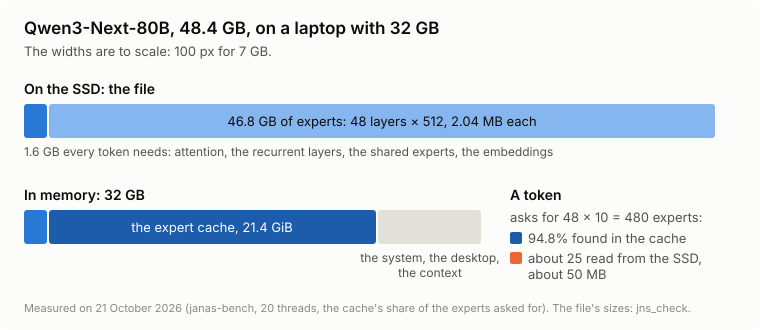
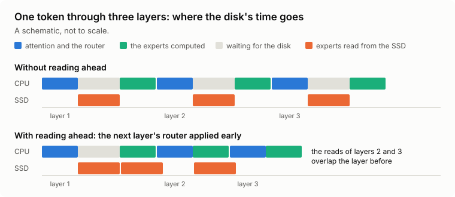
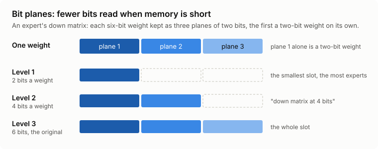

# How Janas-LLM runs a model larger than the memory

**In brief.** Qwen3-Next-80B is a 48.4 GB file, and the laptop it grew on has 32 GB of memory. Janas-LLM writes its replies at 26.4 tokens a second there, where llama.cpp writes 3.0. A token does not need the whole file: it needs 1.6 GB that never changes and 10 of the 512 experts of each layer. Janas-LLM keeps in memory the experts that are asked for most, reads the others straight from the SSD, and reads them before they are asked for whenever it can.

The figures on this page were measured on that laptop: Debian 13, an Intel Core Ultra 9 185H, 32 GB of DDR5-5600, an NVMe SSD. How they were measured is in the [README](../README.md#how-the-figures-were-measured).

## The problem: 48 GB through 32

A mixture of experts replaces each layer's feed-forward block with many small ones, the experts, and a router that picks a few of them for each token. Qwen3-Next-80B's file says what that means in bytes (`jns_check`, which reads the file's header):

| | |
|---|---|
| layers | 48 |
| experts in each layer | 512 |
| experts a token uses in each layer | 10 |
| one expert | 2.04 MB |
| all the experts | 46.8 GB |
| everything else: attention, the recurrent layers, the shared experts, the embeddings | 1.6 GB |

The file does not fit in 32 GB of memory beside the system, the desktop and the model's own working memory. A token touches at most 1.6 GB plus 48 × 10 = 480 experts, which is 480 × 2.04 MB = 979 MB of experts: one fiftieth of the experts in the file.

*The balance so far: 48.4 GB on the disk, at most 2.6 GB of it read for one token.*

## The obvious way, and what it gives

The obvious way is to map the file into memory and let the operating system bring in the pages a token touches, keeping the recent ones in its page cache. That is what llama.cpp does when a model is larger than the memory, and on this laptop it wrote Qwen3-Next-80B's replies at 3.0 tokens a second.

The page cache knows nothing of experts. It keeps what was read last, whatever that was. It reads ahead what lies next in the file, where the next expert a token needs can be anywhere. And it competes for memory with everything else on the machine.

## Janas-LLM's way

### An expert cache of its own

When the model opens, Janas-LLM measures the memory that is free and takes most of it for a cache of expert slots, each as large as one expert. On the laptop that was 21.4 GiB for Qwen3-Next-80B. The rest of the model stays in memory whole.

An expert a token asks for is either in a slot already, or it is read from the file into a slot with `O_DIRECT`, past the page cache, by a pool of I/O threads that read the misses of a layer in parallel. When a slot has to be given up, the cache gives up the expert used longest ago, never one the current layer needs.

The first prompt fills it: the experts a prompt asks for are the ones its reply will ask for, most of the time, and the cache fills with the rest in the background.

*The balance: with a 21.4 GiB cache, 95% of the experts Qwen3-Next-80B's tokens asked for were found in memory (94.8%, 21 October 2026). Five in a hundred of a token's 480 is 25 experts, about 50 MB read from the SSD for each token.*

### Reading before being asked

The router of the next layer can be applied before the current layer has finished. Its choice is then known early, and the experts it picks that are not in memory are read while the current layer computes. This only pays when the cache misses many experts, and the engine turns it on only then.  Qwen3-Next-80B with a 4 GiB cache: 6% faster. A prompt is read the same way, a block at a time: with it, Qwen3-Next-80B read 4,096 tokens at 36.8-42.0 tokens a second with a 4 GiB cache, and at 48.5-50.0 with 16 GiB.

### Fewer bits where they cost least

A converted model (`.jns`, the format `gguf2jns` writes) can keep the down matrix of each expert in bit planes: two bits, two more, and two more, each a part of the six-bit weights the original holds. When memory is short, the engine reads the first two planes or the first four and leaves the rest. A slot is then smaller, and the same cache holds more experts. The engine's report says which it chose ("down matrix at 4 bits (memory)").

### Drafts

A model's prediction block (the Qwen3.5, Qwen3.6 and Qwen3-Next models carry one), or a small drafting model, or the conversation itself, guesses a few tokens ahead. The model checks them all in one pass, which reads each expert once for several tokens. The text is the same, and it comes sooner. In the chat, asked how bread is made at home, Qwen3-Next-80B wrote its reply at 31-35 tokens a second with the cache warm (21 October 2026); `janas-bench`, without drafts, measured 26.4 the same day.

### Three ways for a prompt

A prompt is read in blocks of tokens, where the arithmetic counts more than the bytes. A block goes to the CPU's tiled products (on 512 bits where the processor has AVX-512 VNNI), to the integrated or discrete GPU (the fast prompt, through Vulkan), or to Intel's NPU. The engine measures them and keeps the fastest for each kind of pass. On the laptop the GPU read Qwen3-Next-80B's 1,024 tokens at 68.4 tokens a second, against llama.cpp's 17.7 on the same GPU.

### Measured, not guessed

How many threads write a reply, how many read a prompt, whether the GPU takes part in the short passes: the engine tries the configurations the machine offers on the first passes of each kind, keeps the fastest, tries the others now and then, and remembers its choices for the machine and the model in `~/.cache/janas`. Here it settled on all 20 threads for Qwen3-Next-80B's replies; on an i9-14900HX every thread wrote at less than half the speed of the performance cores' 16.

## The proof

| Qwen3-Next-80B-A3B, 48.4 GB, on 32 GB (21 October 2026) | Janas-LLM | llama.cpp |
|---|---:|---:|
| reading 1,024 tokens | 68.4 tok/s | 17.7 tok/s |
| writing, no drafts | 26.4 tok/s | 3.0 tok/s |
| experts found in memory | 94.8% | (the page cache's, not counted) |

The same comparison for every model tried, and the conditions of each, are in the [README](../README.md). What the engine does while it answers - the cache, the disk, the phases of a pass, the experts layer by layer - can be watched as it happens: [docs/monitor.md](monitor.md).
