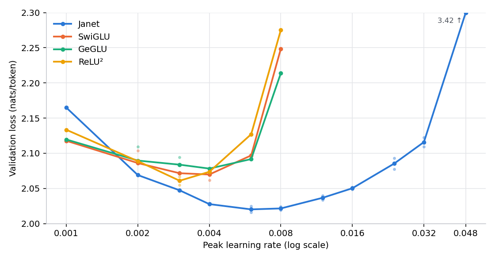
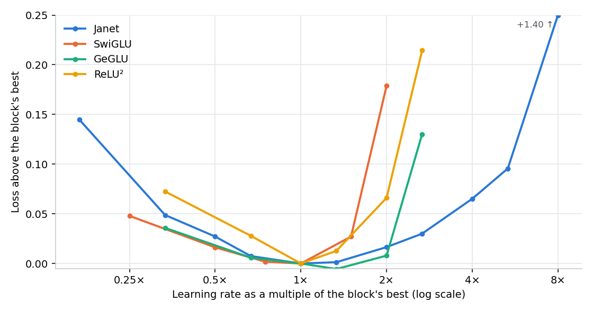
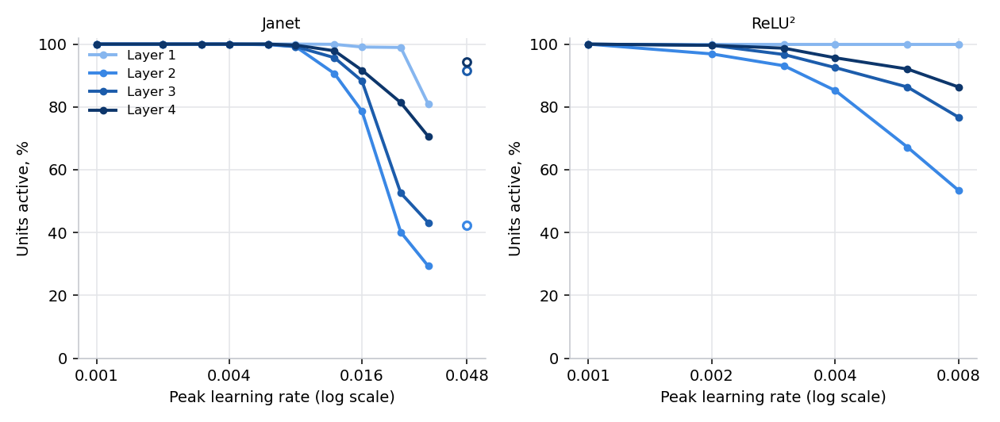
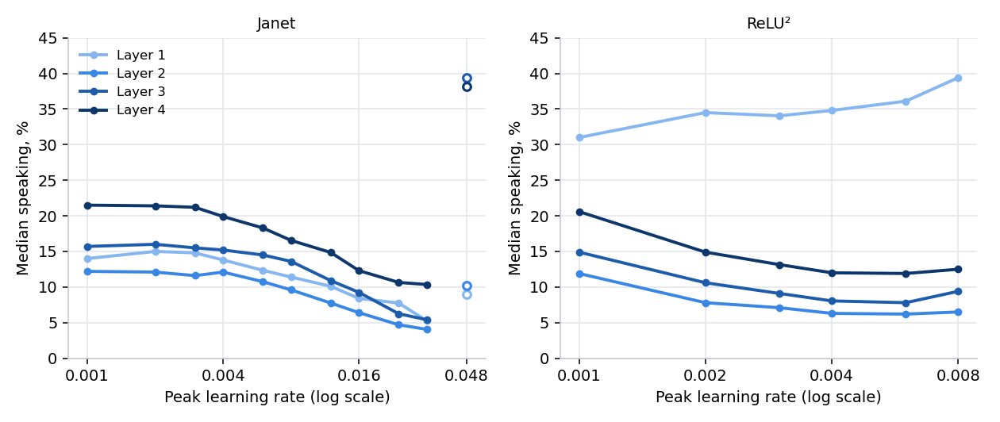
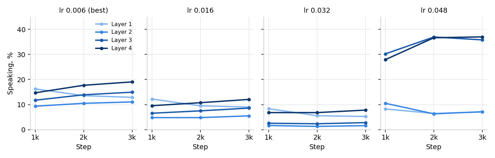
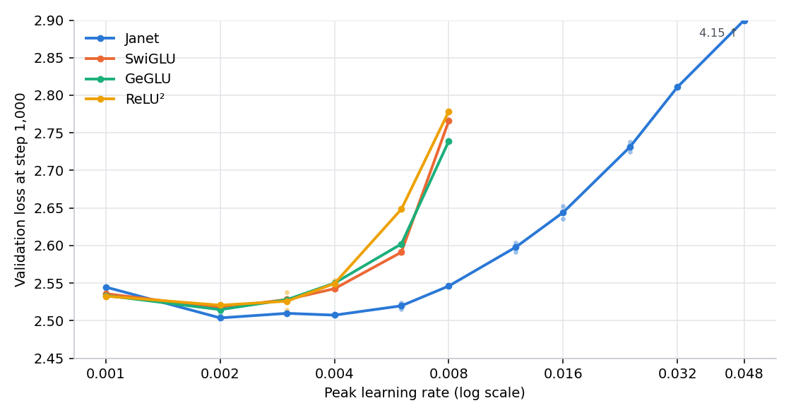
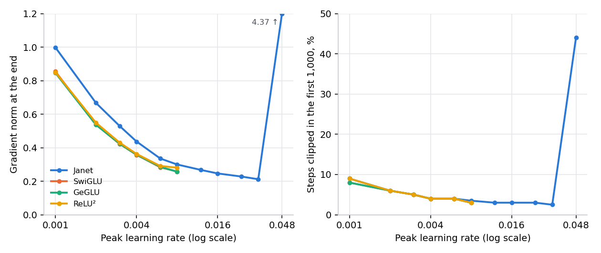
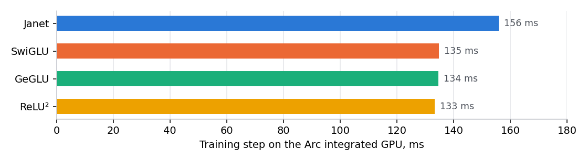

# How Janet responds to the learning rate

*Janet research note, 4 November 2026. A first comparison: TinyStories, 3.34 M parameters, 3,000 steps, 42 training runs on an Intel Arc integrated GPU. The same note as a [PDF](janet-lr-study.pdf), and as an [interactive page](janet-lr-study.html) whose charts you can explore (download it and open it in a browser).*

*© 2026 Maurizio "camauri" Cammalleri. Licensed under [CC BY 4.0](https://creativecommons.org/licenses/by/4.0/).*

*Revised on 4 November 2026 after a critical review: the summary now leads with the learning-rate tolerance and gives the optimum as a range, the order of the classic blocks is no longer stated, the training step time moved to an appendix, and the planned measurements include three seeds per rate and a test of the training settings.*

A small language model was trained over and over with a different feed-forward block each time, at a range of peak learning rates. Each block was then pushed past its best observed rate, to see how and where it degrades.

This is a first, exploratory comparison. Janet received more runs than the other blocks, and the classic blocks were not taken to their breaking point. Further measurements will follow with the same runs for every block: the same grid of rates, the same two seeds at every rate, and every block taken to its breaking point. Until then the results below are trends to be confirmed, not settled findings.

## In short

- **Learning-rate tolerance.** At 1.6e-2, 2.7 times its best observed rate, Janet (2.050) is still better than every classic block at its own best observed rate (2.061-2.084). At 8e-3 Janet's runs score 2.019-2.024, the classic blocks' 2.21-2.28. The classic blocks were not yet taken past 8e-3, so how they degrade beyond it is not known.
- **The optimum, as a range.** Janet's four runs at its two best rates (6e-3 and 8e-3) score 2.016-2.025. The best single runs of the classic blocks score 2.055-2.070. With two seeds, and more runs for Janet, this is a trend to confirm, not a measured gap.
- **Inactive units.** Around its optimum fewer than 1% of Janet's units are inactive. At 5.3 times its best rate, 56-85% of layer 2's are, depending on the seed: past the optimum they grow with no plateau. ReLU² loses its units too, and sooner.
- **The weak side.** Below its optimum Janet is the weakest of the four: at 1e-3 it scores 2.165, against 2.118-2.133.

## What was compared

A transformer language model alternates two kinds of block: attention, which mixes information across positions, and a feed-forward block, which transforms each position on its own. Almost all of a model's weights, and most of the reading of weights at inference time, sit in the feed-forward blocks. This study keeps the whole model fixed and swaps only that block.

**Janet** is the feed-forward block of the Janas project. Each of its units looks at its input through a few separate branches, each branch seeing its own part of the input, and the unit speaks only when its branches agree. When they do not, the unit is silent: its output is exactly zero and, at inference time, its weights need not be read at all. The silence is designed in.

The other three are the blocks used by today's language models. **SwiGLU** (LLaMA, Qwen, Mistral and most others) and **GeGLU** (Gemma) multiply two projections of the input, one passed through a smooth gate. Their units are practically never exactly silent. **ReLU²** (the squared rectifier, used for instance in Nemotron-H) zeroes negative values and squares the rest, so some of its units are silent on any given input, but not by design.

All four were given the same number of parameters (3.34 million in the whole model, within 0.01%). Each classic block uses the standard recipe from the literature: SwiGLU and GeGLU with a hidden width of 8/3 the model width (512 units), ReLU² with four times it (768). Janet has 752 units. None of Janet's own block settings were given to the others.

## How it was measured

**The model** is small: width 192, 4 layers, 3 attention heads, a context of 128 tokens and a vocabulary of 4,096 tokens. Each run trains for 3,000 steps of 32 sequences of 128 tokens, about 12 million tokens of TinyStories.

**The training settings** are the same for every block:
- AdamW, weight decay 0.1, beta2 0.99, gradient clipping at norm 1;
- a 200-step warm-up to the peak learning rate, then a cosine decay down to 1e-4;
- the same data order.

These are the training program's defaults, set during Janet's development, and were not tuned for any block. The score is the cross-entropy loss on held-out text (lower is better), in nats per token.

**The runs:**
- Every block was trained at six peak learning rates from 1e-3 to 8e-3 with one seed; the grid steps are 1.33 to 2 times apart.
- Each block then got a second seed at its two best rates according to the first seed.
- Because Janet was still flat at 8e-3, it alone was taken higher, with two seeds per rate, until it broke (at 4.8e-2).

So Janet has 18 runs, against 8 for each classic block. The seed counts differ too: Janet has two seeds at every rate from 6e-3 up, the others only at their two best rates.

**Two measures of activity.** During training, the program records the share of unit-positions where a unit speaks, layer by layer; this is the *speaking share* of figure 5 and of the appendix.

After training, each saved Janet and ReLU² model was probed on 8,192 held-out positions. A unit counts as *active* if it speaks on at least 0.5% of them (41 positions), and as *inactive* otherwise; figure 4 gives the median share of positions where an active unit speaks. "Dead" below is shorthand for inactive in this sense: an inactive unit may still speak on a few positions. SwiGLU and GeGLU have no comparable measure, since their units never fall silent.

## The optimum

**Figure 1. Final validation loss against peak learning rate.** Faint dots are single runs, lines join the mean at each rate. The three classic blocks have a shallow minimum between 2e-3 and 4e-3 (flat within about 0.02) and climb steeply after it. Janet improves up to 6e-3, stays flat to 8e-3, then rises slowly up to 3.2e-2, where it is still better than any classic block at 8e-3. At 4.8e-2 it breaks (3.42, off this scale).

At each block's best observed rate, averaged over two seeds:

| Block | Best observed peak rate | Mean of two seeds | Spread between seeds | Behind Janet |
|---|---|---|---|---|
| Janet | 6e-3 | 2.0202 | 0.009 | — |
| ReLU² | 3e-3 | 2.0609 | 0.012 | +0.041 |
| SwiGLU | 4e-3 | 2.0698 | 0.017 | +0.050 |
| GeGLU | 3e-3 | 2.0838 | 0.022 | +0.064 |

**How large is the noise?** Over every rate where a block has two seeds, the two differ by:
- 0.003 to 0.016 for Janet;
- 0.003 to 0.039 for the classic blocks.

Estimated from these pairs, the standard deviation of a single run is about 0.007 for Janet and 0.018 for the classic blocks. The standard error of the difference between two two-seed means is then about 0.013.

**What that makes of the results:**
- Janet's 0.041 lead over ReLU² is about three standard errors: a clear trend, but not established with two seeds.
- Janet's runs also look less scattered than the others', but six pairs per side are too few to be sure.
- The three classic blocks are within 0.023 of each other, and their order is not resolved.

Below the optimum the four lose alike: 0.04 to 0.07 at a third or a quarter of their best rate. At 1e-3, a sixth of its best, Janet is the worst of the four (2.165, against 2.118-2.133). It is also the only run in which clipping still acts at the end of training (43% of the last thousand steps). Janet needs its higher rate.

**Figure 2. Distance from each block's own best, against the peak learning rate as a multiple of its best.** This puts the four on the same footing: how much does each lose when the rate is wrong by a given factor? Read it with two cautions:
- The multiples are only as precise as the grid (steps of 1.33 to 2) and the one or two seeds that located each best.
- At twice their best rate the classic blocks lose 0.008 (GeGLU), 0.066 (ReLU²) and 0.179 (SwiGLU). The gap between GeGLU and SwiGLU comes from their bests falling one grid step apart (3e-3 and 4e-3): in absolute rate their curves agree within 0.035 at every rate (figure 1).

At 8e-3, two to three times their best, all three classic blocks are 0.13 to 0.21 above it. Janet loses 0.016 at 2×, 0.030 at 2.7× and 0.065 at 4×.

## Past the optimum: two ways of degrading

Above its best observed rate, Janet degrades in two distinct regimes.

- **Between 1.2e-2 and 3.2e-2 the loss rises gradually,** by 0.015 to 0.035 per step up the ladder. The rise steepens towards the top, from about 0.05 to about 0.11 per e-fold of the rate. Training stays stable: the gradient stays small, and clipping does not act after the first thousand steps.
- **At 4.8e-2 training becomes unstable in the usual way.** The gradient grows roughly twentyfold, clipping acts on half the steps or more, and the loss ends at 3.4.

The gradual regime is where Janet's units become inactive.

**Figure 3. Units still active, by layer.** Points are the mean of the seeds trained at that rate. The hollow points at 4.8e-2 belong to the broken regime: the network there no longer learns (loss 3.4), and "active" means something else, so they are not joined to the curves.

- **Janet:** around its optimum (6e-3 and 8e-3) at most 7 of the 752 units of any layer are inactive. From 1.2e-2 upwards more become inactive at every step, starting from layers 2 and 3. At 3.2e-2, layer 2 keeps between 15% and 44% of its units, depending on the seed.
- **ReLU²:** already 7% of its layer-2 units are inactive at its best rate (3e-3), and they grow faster with the rate. A third of layer 2 is inactive at 6e-3, twice its best, and 47% at 8e-3, where Janet has 1%.

**The two pictures go together.** Janet's loss is lowest at 6e-3 and 8e-3, which are indistinguishable within the seed spread, and there fewer than 1% of the units are inactive. The loss starts to rise at 1.2e-2, where layer 2 has lost 9%. The rise steepens from 2.4e-2, where layer 2 has lost 45-75% of its units, depending on the seed.

The units that stay active also speak less: in layer 2 the median active unit speaks on 10-11% of positions at the optimum and 3.5-4.6% at 3.2e-2.

**Inactive units are not peculiar to Janet.** ReLU², the other block whose units can fall silent, shows the same thing, and sooner. Measured against each block's own best rate, at twice the optimum Janet has lost 9% of layer 2 and ReLU² 33%. In both blocks, units that can be switched off become inactive when the steps are too large, and Janet's resist longer.

**One reading, consistent with figures 1 and 3 but not tested directly,** is that Janet degrades gradually because it sheds capacity one unit at a time, while the rest of the network carries on with the units that remain. What the classic blocks do above 8e-3 was not measured. Whatever the mechanism, the flat region above Janet's optimum has a cost the loss alone hides. On a larger model or a longer run, that loss of units could accumulate, and it has to be measured there.

**Figure 4. How often an active unit speaks** (median over the active units of each layer). At its optimum the median Janet unit speaks on 10-18% of positions, depending on the layer. As the rate rises the middle layers fall to 3.5-6%. At 4.8e-2 (hollow points, broken regime) layers 3 and 4 jump to 37-40%, two to three times the optimum, as the unstable network loses its sparsity.

**Figure 5. Janet's speaking share during training, by layer, at four learning rates,** measured on held-out text at steps 1,000, 2,000 and 3,000. At the optimum (6e-3) the layers settle at 10-19%. At higher rates the middle layers are lower from the first measurement and recover only slightly, by a point or two, as the cosine schedule lowers the rate. At 4.8e-2 layers 3 and 4 rise instead.

**Figure 6. Validation loss after 1,000 of the 3,000 steps.** High rates do most of their damage early.
- **Janet at 1.2e-2:** behind its optimum by 0.08 at step 1,000, and by only 0.017 at the end: the decay repairs most of it.
- **The classic blocks at 8e-3:** 0.21 to 0.25 behind at step 1,000, and still 0.13 to 0.21 behind at the end.
- **Janet at 4.8e-2:** 4.15 at step 1,000 (off scale).

**Figure 7. Training stability.** In every block the final gradient norm falls as the rate rises, from about 0.85-1.0 at 1e-3 to about 0.21-0.30. Clipping acts only in the first thousand steps, and less at higher rates, so it does not hold anything back below the breaking point. There are two exceptions:
- **Janet at 1e-3:** its gradient norm ends at the clipping threshold, and 43% of its last thousand steps are clipped.
- **Janet at 4.8e-2:** norm 3.7-5.0, clipping on 40-48% of the first thousand steps and 50-67% at the end (off scale).

## Why do Janet's units become inactive?

Four explanations were on the table. The data rule out one and support one.

- **Clipping holds back the updates.** Ruled out: below the breaking point clipping acts only early on, and less at high rates (figure 7).
- **Units go silent at high rates and stop learning.** Supported only as the accompaniment of the gradual regime: the loss rises as units fall below the threshold (figures 3 and 4). Whether silent units stop learning, and what silences them, was not measured.
- **Janet's weights grow until the effective step stays the same whatever the nominal rate.** Not yet tested: it needs the size of each group of weights through training. The falling gradient norm in every block (figure 7) is consistent with growing weights, but does not prove it.
- **Janet steadies the rest of the network.** Attention and embeddings train at the same rate as the feed-forward block. If Janet's block keeps the signal tame, they too tolerate higher rates. Not yet tested: it needs one rate for the feed-forward block and another for the rest.

## Limits

- **One small model and a short run:** 3.34 M parameters, 3,000 steps, about 12 M tokens, one dataset and one tokenizer. This is far from a fully trained model, and a preference for high learning rates in short runs may not hold in long ones. The differences may shrink or grow with size and length.
- **Unequal runs:** Janet had 18 runs and each of the others 8; Janet had a second seed at every rate from 6e-3 up, the others only at their two best. More runs give more chances of a lucky minimum, so the comparison slightly favours Janet.
- **Selected second seeds:** the second seed's rates were chosen from the first seed's results. So each two-seed mean at a best rate carries part of the first seed's selection, equally for every block.
- **Two seeds** show trends, not significance. GeGLU's best two-seed mean, 2.084 at 3e-3, could move by about ±0.02; its single run at 4e-3 scored 2.078.
- **The classic blocks were not pushed to their breaking point;** above 8e-3 their behaviour is not measured.
- **Inactive units** are counted on 8,192 positions with a 0.5% threshold, the same for both blocks, and only for Janet and ReLU². How the counts depend on the threshold is not yet measured. With four layers, "the middle layers" are two of four.
- **The training settings** are the training program's defaults, set during Janet's development, and not tuned for any block.
- **The step time** is the whole model's, on the project's own training program and one integrated GPU. It is not an inference measurement.

## Next

Further measurements will follow, so that the comparison is more precise and fair:
- **Equal runs for every block:** the same grid of rates from 1e-3 to 4.8e-2 for all four, three seeds at every rate, and every block taken to its breaking point.
- **The training settings:** each block at its best rate again with a different weight decay (0.05 and 0.2), a longer warm-up and a different beta2, to see whether the ranking depends on settings that came from Janet's development.
- **The activity threshold:** inactive units counted again at 0.1%, 1% and 5% as well as 0.5%.
- **Weight sizes through training,** to test the third explanation.
- **One rate for the feed-forward block and another for the rest,** to test the fourth.
- **Then:** a larger vocabulary, a larger model and a longer run, and a remedy against inactive units.

The machine running these measurements is shared with other work, so they will come in stages.

## Appendix: training step time

**Appendix figure. Training step time on the Arc integrated GPU** (median over all runs of each block). Janet's step costs about 16% more. This is the whole model's step, attention and embeddings included, so the block's own overhead is larger. It was measured on the project's own GPU training program and does not transfer to other software. That program computes every unit, silent or not, so this figure says nothing about inference, where a silent unit's weights are not read. No claim about speed is made here.

## License

This document, its text, charts and tables, is © 2026 Maurizio "camauri" Cammalleri and is licensed under the Creative Commons Attribution 4.0 International License (CC BY 4.0): you may copy, redistribute and adapt it for any purpose, including commercially, provided you give appropriate credit, link to the license, and indicate if changes were made. The license text is at <https://creativecommons.org/licenses/by/4.0/>. It covers this document only, not the Janas or Janet source code.

## Appendix: every run

Validation loss after 3,000 steps and after 1,000; the speaking share of each layer at the end; the share of the first thousand steps clipped; the final gradient norm; the step time.

| Block | Peak LR | Seed | Val loss | Val at 1k | Speaking share % by layer | Clipped in 1k | Grad norm | ms/step |
|---|---|---|---|---|---|---|---|---|
| Janet | 0.001 | 1 | 2.1649 | 2.5447 | 14.4 / 12.7 / 16.3 / 22.2 | 9% | 0.998 | 155 |
| Janet | 0.002 | 1 | 2.0690 | 2.5037 | 15.4 / 12.5 / 16.3 / 21.9 | 6% | 0.667 | 155 |
| Janet | 0.003 | 1 | 2.0473 | 2.5098 | 15.5 / 12.0 / 16.0 / 21.6 | 5% | 0.529 | 155 |
| Janet | 0.004 | 1 | 2.0277 | 2.5074 | 14.7 / 12.5 / 15.9 / 20.7 | 4% | 0.437 | 157 |
| Janet | 0.006 | 1 | 2.0246 | 2.5241 | 12.6 / 11.8 / 14.2 / 19.2 | 4% | 0.336 | 159 |
| Janet | 0.006 | 2 | 2.0158 | 2.5155 | 13.2 / 10.3 / 15.7 / 18.9 | 4% | 0.335 | 155 |
| Janet | 0.008 | 1 | 2.0191 | 2.5467 | 12.4 / 10.3 / 13.2 / 17.1 | 4% | 0.304 | 156 |
| Janet | 0.008 | 2 | 2.0240 | 2.5456 | 11.9 / 9.6 / 14.4 / 17.4 | 3% | 0.296 | 155 |
| Janet | 0.012 | 1 | 2.0396 | 2.6036 | 10.9 / 7.8 / 10.6 / 15.6 | 3% | 0.268 | 156 |
| Janet | 0.012 | 2 | 2.0338 | 2.5919 | 11.0 / 6.8 / 11.2 / 14.7 | 3% | 0.267 | 156 |
| Janet | 0.016 | 1 | 2.0518 | 2.6526 | 8.9 / 6.5 / 7.2 / 11.8 | 3% | 0.244 | 156 |
| Janet | 0.016 | 2 | 2.0487 | 2.6355 | 9.1 / 4.5 / 10.0 / 12.3 | 3% | 0.249 | 156 |
| Janet | 0.024 | 1 | 2.0933 | 2.7376 | 8.7 / 1.3 / 2.4 / 9.2 | 3% | 0.229 | 156 |
| Janet | 0.024 | 2 | 2.0774 | 2.7248 | 8.8 / 3.3 / 5.4 / 9.6 | 3% | 0.227 | 156 |
| Janet | 0.032 | 1 | 2.1225 | 2.8115 | 7.5 / 0.8 / 1.9 / 6.6 | 2% | 0.213 | 156 |
| Janet | 0.032 | 2 | 2.1092 | 2.8102 | 3.0 / 2.4 / 3.7 / 9.0 | 3% | 0.211 | 156 |
| Janet | 0.048 | 1 | 3.4009 | 4.2266 | 9.7 / 9.8 / 32.8 / 36.8 | 40% | 3.720 | 166 |
| Janet | 0.048 | 2 | 3.4452 | 4.0829 | 4.4 / 4.5 / 38.8 / 37.2 | 48% | 5.010 | 161 |
| SwiGLU | 0.001 | 1 | 2.1177 | 2.5359 | 100.0 / 100.0 / 100.0 / 100.0 | 8% | 0.855 | 134 |
| SwiGLU | 0.002 | 1 | 2.0684 | 2.5153 | 100.0 / 100.0 / 100.0 / 100.0 | 6% | 0.544 | 136 |
| SwiGLU | 0.002 | 2 | 2.1037 | 2.5192 | 100.0 / 100.0 / 100.0 / 100.0 | 6% | 0.531 | 134 |
| SwiGLU | 0.003 | 1 | 2.0716 | 2.5282 | 100.0 / 100.0 / 100.0 / 100.0 | 5% | 0.422 | 134 |
| SwiGLU | 0.004 | 1 | 2.0615 | 2.5435 | 100.0 / 100.0 / 100.0 / 100.0 | 4% | 0.359 | 136 |
| SwiGLU | 0.004 | 2 | 2.0781 | 2.5417 | 100.0 / 100.0 / 100.0 / 100.0 | 4% | 0.356 | 134 |
| SwiGLU | 0.006 | 1 | 2.0969 | 2.5911 | 100.0 / 100.0 / 100.0 / 100.0 | 4% | 0.283 | 135 |
| SwiGLU | 0.008 | 1 | 2.2486 | 2.7660 | 100.0 / 100.0 / 100.0 / 100.0 | 3% | 0.258 | 135 |
| GeGLU | 0.001 | 1 | 2.1196 | 2.5335 | 100.0 / 100.0 / 100.0 / 100.0 | 8% | 0.846 | 134 |
| GeGLU | 0.002 | 1 | 2.0700 | 2.5099 | 100.0 / 100.0 / 100.0 / 100.0 | 6% | 0.543 | 136 |
| GeGLU | 0.002 | 2 | 2.1092 | 2.5196 | 100.0 / 100.0 / 100.0 / 100.0 | 6% | 0.530 | 133 |
| GeGLU | 0.003 | 1 | 2.0729 | 2.5259 | 100.0 / 100.0 / 100.0 / 100.0 | 5% | 0.424 | 134 |
| GeGLU | 0.003 | 2 | 2.0946 | 2.5302 | 100.0 / 100.0 / 100.0 / 100.0 | 5% | 0.423 | 135 |
| GeGLU | 0.004 | 1 | 2.0782 | 2.5500 | 100.0 / 100.0 / 100.0 / 100.0 | 4% | 0.358 | 136 |
| GeGLU | 0.006 | 1 | 2.0917 | 2.6021 | 100.0 / 100.0 / 100.0 / 100.0 | 4% | 0.286 | 134 |
| GeGLU | 0.008 | 1 | 2.2139 | 2.7391 | 100.0 / 100.0 / 100.0 / 99.9 | 3% | 0.257 | 135 |
| ReLU² | 0.001 | 1 | 2.1334 | 2.5327 | 31.9 / 12.3 / 15.4 / 21.8 | 9% | 0.850 | 133 |
| ReLU² | 0.002 | 1 | 2.0888 | 2.5206 | 35.1 / 8.3 / 11.7 / 16.1 | 6% | 0.549 | 133 |
| ReLU² | 0.003 | 1 | 2.0669 | 2.5379 | 36.3 / 7.2 / 10.1 / 14.4 | 5% | 0.430 | 133 |
| ReLU² | 0.003 | 2 | 2.0549 | 2.5141 | 33.7 / 7.3 / 9.6 / 14.5 | 5% | 0.430 | 134 |
| ReLU² | 0.004 | 1 | 2.0722 | 2.5542 | 36.9 / 6.5 / 8.7 / 12.8 | 4% | 0.364 | 135 |
| ReLU² | 0.004 | 2 | 2.0751 | 2.5447 | 34.9 / 5.9 / 8.3 / 12.6 | 4% | 0.362 | 135 |
| ReLU² | 0.006 | 1 | 2.1270 | 2.6484 | 37.6 / 4.8 / 7.8 / 12.2 | 4% | 0.291 | 133 |
| ReLU² | 0.008 | 1 | 2.2753 | 2.7786 | 40.3 / 4.9 / 8.6 / 12.0 | 3% | 0.281 | 133 |

## Appendix: active units by layer

Units speaking on at least 0.5% of 8,192 held-out positions, out of the layer's units, and in brackets how often the median active unit speaks.

| Block | Peak LR | Seed | Layer 1 | Layer 2 | Layer 3 | Layer 4 |
|---|---|---|---|---|---|---|
| Janet | 0.001 | 1 | 752 of 752 (14.0%) | 752 of 752 (12.2%) | 752 of 752 (15.7%) | 752 of 752 (21.5%) |
| Janet | 0.002 | 1 | 752 of 752 (15.0%) | 752 of 752 (12.1%) | 752 of 752 (16.0%) | 752 of 752 (21.4%) |
| Janet | 0.003 | 1 | 752 of 752 (14.8%) | 752 of 752 (11.6%) | 752 of 752 (15.5%) | 752 of 752 (21.2%) |
| Janet | 0.004 | 1 | 752 of 752 (13.8%) | 752 of 752 (12.1%) | 752 of 752 (15.2%) | 752 of 752 (19.9%) |
| Janet | 0.006 | 1 | 752 of 752 (12.2%) | 751 of 752 (11.4%) | 752 of 752 (13.7%) | 752 of 752 (18.4%) |
| Janet | 0.006 | 2 | 752 of 752 (12.5%) | 750 of 752 (10.1%) | 752 of 752 (15.3%) | 752 of 752 (18.2%) |
| Janet | 0.008 | 1 | 752 of 752 (11.6%) | 745 of 752 (10.0%) | 745 of 752 (13.0%) | 750 of 752 (16.6%) |
| Janet | 0.008 | 2 | 752 of 752 (11.2%) | 747 of 752 (9.2%) | 747 of 752 (14.2%) | 749 of 752 (16.5%) |
| Janet | 0.012 | 1 | 752 of 752 (10.1%) | 694 of 752 (8.2%) | 717 of 752 (10.7%) | 737 of 752 (15.4%) |
| Janet | 0.012 | 2 | 751 of 752 (10.1%) | 669 of 752 (7.3%) | 722 of 752 (11.1%) | 735 of 752 (14.3%) |
| Janet | 0.016 | 1 | 746 of 752 (8.3%) | 644 of 752 (7.1%) | 639 of 752 (8.1%) | 691 of 752 (12.0%) |
| Janet | 0.016 | 2 | 744 of 752 (8.5%) | 539 of 752 (5.7%) | 689 of 752 (10.4%) | 688 of 752 (12.6%) |
| Janet | 0.024 | 1 | 747 of 752 (7.8%) | 187 of 752 (4.5%) | 282 of 752 (5.2%) | 608 of 752 (10.4%) |
| Janet | 0.024 | 2 | 741 of 752 (7.7%) | 417 of 752 (4.9%) | 509 of 752 (7.3%) | 616 of 752 (10.9%) |
| Janet | 0.032 | 1 | 733 of 752 (6.9%) | 113 of 752 (3.5%) | 248 of 752 (4.7%) | 498 of 752 (9.2%) |
| Janet | 0.032 | 2 | 484 of 752 (3.6%) | 328 of 752 (4.6%) | 401 of 752 (6.1%) | 564 of 752 (11.5%) |
| Janet | 0.048 | 1 | 396 of 752 (12.2%) | 384 of 752 (13.1%) | 653 of 752 (38.8%) | 706 of 752 (39.1%) |
| Janet | 0.048 | 2 | 239 of 752 (5.8%) | 252 of 752 (7.3%) | 726 of 752 (39.9%) | 714 of 752 (37.3%) |
| ReLU² | 0.001 | 1 | 768 of 768 (31.0%) | 768 of 768 (11.9%) | 768 of 768 (14.9%) | 768 of 768 (20.6%) |
| ReLU² | 0.002 | 1 | 768 of 768 (34.5%) | 744 of 768 (7.8%) | 765 of 768 (10.6%) | 765 of 768 (14.9%) |
| ReLU² | 0.003 | 1 | 768 of 768 (35.4%) | 727 of 768 (7.0%) | 746 of 768 (9.5%) | 757 of 768 (13.1%) |
| ReLU² | 0.003 | 2 | 768 of 768 (32.7%) | 703 of 768 (7.2%) | 739 of 768 (8.7%) | 759 of 768 (13.2%) |
| ReLU² | 0.004 | 1 | 768 of 768 (35.7%) | 700 of 768 (6.4%) | 710 of 768 (8.2%) | 736 of 768 (12.0%) |
| ReLU² | 0.004 | 2 | 768 of 768 (33.9%) | 609 of 768 (6.2%) | 711 of 768 (7.9%) | 733 of 768 (12.0%) |
| ReLU² | 0.006 | 1 | 768 of 768 (36.1%) | 516 of 768 (6.2%) | 663 of 768 (7.8%) | 707 of 768 (11.9%) |
| ReLU² | 0.008 | 1 | 768 of 768 (39.4%) | 410 of 768 (6.5%) | 589 of 768 (9.4%) | 663 of 768 (12.5%) |
