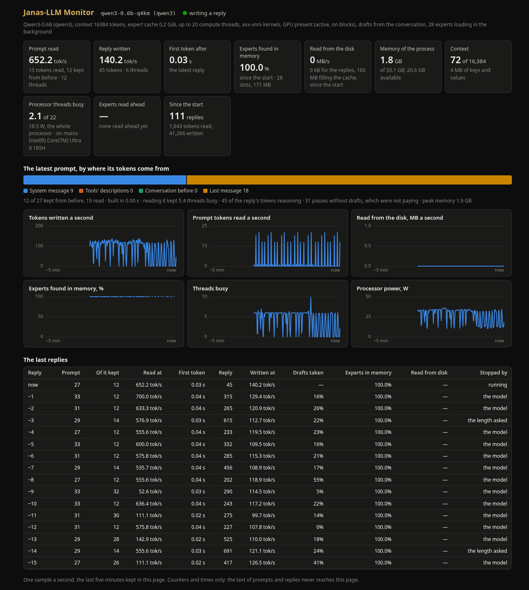

# The engine at work

Janas can show what its engine is doing while it answers: how fast the latest replies read their prompt and wrote, where the experts of a mixture came from, how much memory and processor it takes. In a browser with `janas-server --monitor`, in the terminal with `janas-chat`'s `/monitor`. Both read the same counters, which every reply keeps anyway, and show counters and times only: the text of a prompt or a reply never reaches them.

What it showed on the development laptop (Intel Core Ultra 9 185H, 32 GB, Linux), with `janas-server` and Qwen3-0.6B answering short questions one after the other for ten minutes, 10 November 2026: prompts of 27 to 33 tokens read at 53-700 tok/s, replies of 198 to 691 tokens written at 100-140 tok/s, the first token after 0.02-0.05 s, the experts all found in memory, 1.8 GB held by the process, 2-6 of 22 threads busy and 18-32 W for the whole processor.



## In a browser: `janas-server --monitor`

```sh
janas-server qwen3-4b-q4km.jns --monitor
```

Then open `http://127.0.0.1:8080/monitor` (the server says where, when it starts). The page takes a sample a second from `/monitor/events`, a stream of Server-Sent Events. Where the server has a key (`--api-key`), the events are behind it and the page asks for it; the page itself is not. It is inside the program, loads nothing from anywhere else and talks only to this server; it follows the system's light or dark theme and reads on a phone.

- **The latest reply:** how fast its prompt was read and the reply written, how long the first token took, the drafts taken and the threads of each.
- **The prompt by where its tokens come from:** the system message, the tools' descriptions, the conversation before and the last message, as a bar. Under it: how much was kept from before (computed for an earlier reply, not read again), how long the prompt took to build, how many threads reading it kept busy, the reasoning tokens and whether the limit cut them, the passes the engine ran without drafts because they were not paying, and the peak memory.
- **The expert cache**, for the mixtures of experts: the share of the experts found in memory since the start, what was read from the disk for the replies and to fill the cache, and how fast now; the experts read ahead and how many of them a layer then asked for; the time the reads took in the background against the time the replies waited for them. With a GPU that has memory of its own, the experts its passes found there, read into it, or left to the CPU.
- **Memory and processor:** the process's memory against the machine's, the context and the memory of its keys and values, the threads busy, whether the machine runs on mains or on battery. On Linux, where the processor's energy counter (RAPL) can be read without privileges, the whole processor's watts: the processor's, not the server's alone.
- **Where the engine's time goes:** the seconds of the last ten spent in each phase of the passes, as a bar: attention (queries, keys and values, attention, its output), the feed-forward and the experts (the router and the experts), the output head, the recurrent layers, the mixes of qwen4exp's streams; since the start when nothing ran in the last ten. Under it, what the engine chose for each kind of pass (threads, the GPU, the time a token took). These are counters the engine keeps anyway. Qwen3-Coder-30B-A3B, answering three questions on code on the laptop (10 November 2026), spent 29% of its time in attention, 61% in the feed-forward and the experts and 10% in the output head.
- **The last five minutes:** tokens written and prompt tokens read a second, the disk's MB a second, the share of the experts found in memory, the threads busy and the watts, each in a chart of its own; the value at any moment under the pointer.
- **The last 16 replies**, a row each: prompt, kept, read at, first token, reply, written at, drafts taken, experts in memory, read from the disk, and what ended it.

The page keeps the five minutes itself: they start when it is opened.

With `janas-setup serve --monitor`, the servers it starts for an editor serve the same page; the extension for VS Code and VSCodium starts them so (setting `janas.monitor`), and **Janas: Show the engine at work** opens it.

### Inside the layers

**Look inside the layers** asks the server for more: while the page shows them (`/monitor/events?layers=1`), the engine gathers, at every pass of its layer loop on the CPU,

- **the neurons of the feed-forward**: for each layer, the mean |activation| of its neurons in 32 groups, a row a layer, each row scaled to its own largest (a dense model's feed-forward, or a mixture's shared expert);
- **the residual after each layer**: the mean |value| of the residual stream at the last token of each pass, in 32 groups, a row a layer;
- for a mixture of experts, **the experts chosen**: how many times each expert of each layer was chosen, a row a layer and a column an expert (Qwen3-Coder-30B-A3B: 48 rows of 128);
- and **the experts read from the disk**: how many times each was not in memory and was read for the pass.

Each map is drawn in one blue, light for the most and dark for the least on a dark page, the other way on a light one, with the value under the pointer. The maps add up from the moment they are turned on. Looking costs the engine: each pair of a token and an expert, and each layer, is summed as it is computed, so it is gathered only while some page asks for it, and stops when none does. What it cost, measured on the laptop with the same greedy request of a 671-token prompt and 300 tokens written, six pairs with and without it, alternated (10 November 2026): Qwen3-Coder-30B-A3B wrote at 29.4 tok/s with it against 29.9 without, 2% slower and slower in every pair; Qwen3-0.6B at 115.2 against 116.6, within the noise of its pairs. Reading the prompt showed no cost above the noise on either. A pass run whole on a GPU does not go through the layer loop of the CPU and is not seen. `JANAS_MONITOR_EVERY=N` looks at one pass in N.

## In the terminal: `/monitor` in `janas-chat`

`/monitor` lays the same counters out as a page of the chat, made anew every second until ESC closes it: the totals since the start, the latest reply in full (its prompt by its parts, speeds, threads, drafts, reasoning, the context), the expert cache with a bar for the share found in memory, where the engine's time went since the start and what it chose for each kind of pass, the memory and the processor, and the replies before it, a line each. `/monitor layers` turns the look inside the layers on (and off): from the next reply the page shows, a line a layer, the neurons of the feed-forward and the residual in eighth blocks (`▁▂▃▅▇█`), and for a mixture how many experts of each layer were chosen and the share read from the disk. The chat answers one message at a time, so while the page is open no reply is being written; what moves is what goes on in the background - the system message read ahead, the experts filling the cache - and the memory and the processor.

## From a program

The library gives the counters to any program, from any thread, while another thread replies (`include/janas/llm.h`; the same in `llm.bi` for FreeBASIC):

```c
struct janas_llm_monitor m = {.size = sizeof m};
janas_llm_monitor(llm, &m); /* totals, the expert cache, memory, the
                               phases' seconds, the tuner's choices */
struct janas_llm_chat_stats s = {.size = sizeof s};
for (int k = 0; janas_llm_monitor_reply(llm, k, &s) == JANAS_LLM_OK; k++)
    ; /* k 0: the latest reply, perhaps still being written; up to 15 */
```

What they cost: each step of a reply already updates its counters (`janas_llm_chat_stats`); the monitor adds a copy of them under a lock no one holds for long, watched or not. The two functions read that copy, the expert cache's counters under its own lock, and the process's memory.

The look inside the layers: `janas_llm_monitor_layers_on(llm, 1)` from each caller that wants it (and 0 when it no longer does), `janas_llm_monitor_layers_shape` for the layers, the groups and the experts, and `janas_llm_monitor_layers` for what was gathered since the last call: the feed-forward's and the residual's groups, the experts chosen and read from the disk, their mean |activation|, the passes. The engine attaches its observer between two steps of a reply, on its own thread, and detaches it when nobody wants it any longer.
